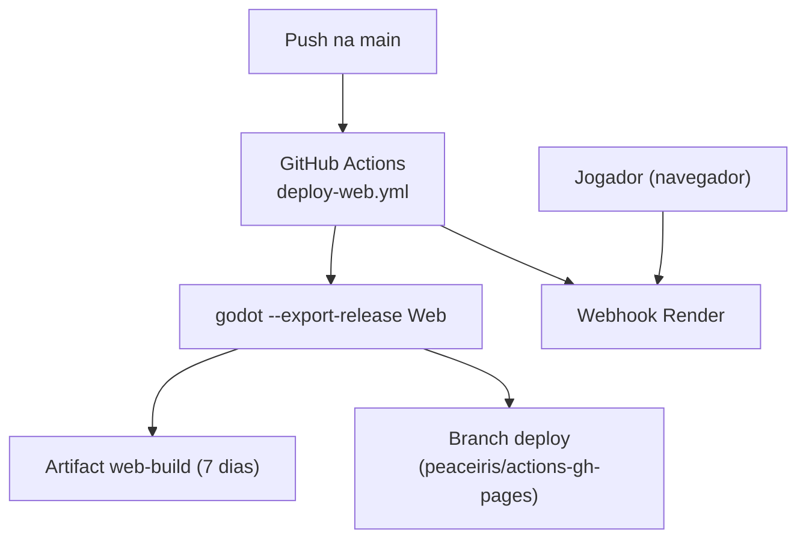

# Arquitetura em Nuvem — godot-pinguim-2d

> Última atualização: 2026-11
<!-- Needs Human Confirmation: verify deployment details from infrastructure team -->

## Ambiente de Implantação

- **Provedor de nuvem:** GitHub Actions + GitHub Pages (branch `deploy`) e Render (via webhook)
- **Orquestração de contêineres:** contêiner `barichello/godot-ci:4.6` apenas no CI
- **Config server:** nenhum
- **Segredos:** GitHub Secrets (`RENDER_WEBHOOK`, `GITHUB_TOKEN`)
- **Registro de imagens:** nenhum

## Mapa de Componentes de Alto Nível

## Zonas de Rede

<!-- Needs Human Confirmation -->

| Zona | Serviços |
|---|---|
| Externa | Navegador do jogador, Render |
| Interna | GitHub Actions |
| Dados | nenhum |
