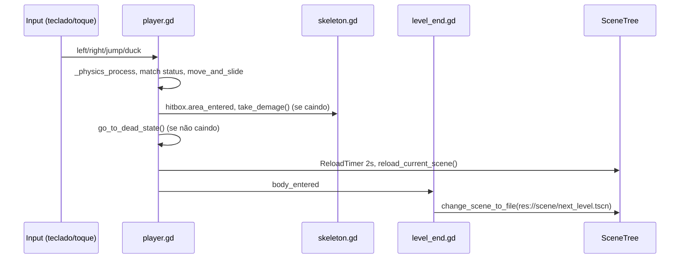

# Fluxo de Dados — godot-pinguim-2d

> Última atualização: 2026-11

## Fluxo Principal de Jogo

## Fluxos de Eventos Kafka

_(nenhum)_

## Contratos de Dados Principais

| Contrato | Formato | Schema / classe |
|---|---|---|
| Input Map | `project.godot` | ações `left`, `right`, `jump`, `duck` |
| Cenas | `.tscn` | `scene/**` |
| Tilesets | `.tres` | `tiles/terrain.tres`, `tiles/decoration/decoração.tres` |
