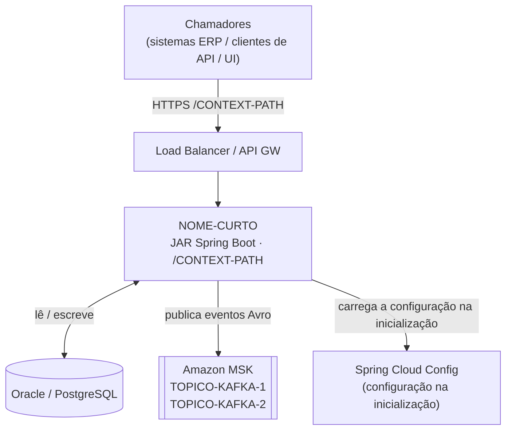
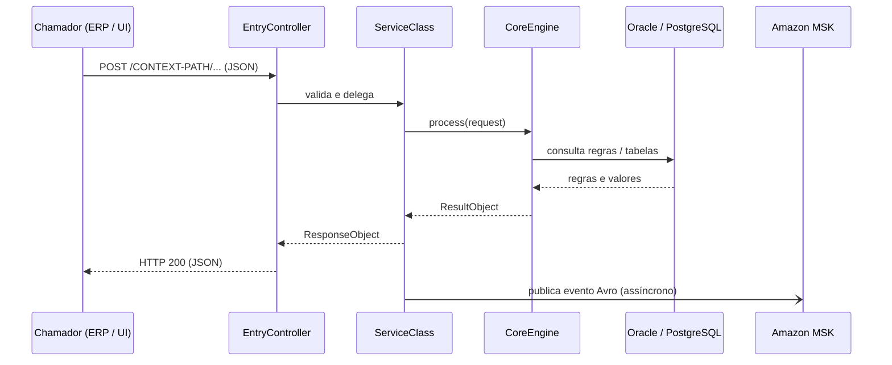

# ⛔ PARE — LEIA ANTES DE FAZER QUALQUER OUTRA COISA

**Esta skill NÃO tem nada a ver com catálogos de serviços (Backstage, Port, Cortex.io).**

Antes de escrever qualquer arquivo, responda internamente a estas quatro perguntas:

1. Vou criar um descritor de catálogo (`catalog-info.yaml`, `port.yml`, `cortex.yaml`)? → **PARE. Está errado. O arquivo é `.mind/manifest.yaml`.**
2. Vou escrever um schema de catálogo (`openapi: 3.0.1` com chaves `x-*` de catálogo, `apiVersion: backstage.io/...`)? → **PARE. Esse schema nunca deve aparecer.**
3. Vou criar só um arquivo? → **PARE. Você deve criar os 17 arquivos listados em Saída Esperada.**
4. Vou escrever `schema-version:` como primeira chave do `manifest.yaml`? → **PARE. Schema errado. A primeira linha que não é comentário deve ser `ai-knowledge-base:`.**

Se respondeu SIM a qualquer uma, descarte essa saída e recomece pelo Passo 0 abaixo.

Terminologia usada nesta skill:

- **`.mind/`** — a pasta de conhecimento dentro de cada repositório: conhecimento **somente deste repo** e de como ele se relaciona com outros repos (dependências, consumidores, contratos). Esta skill escreve essa pasta.
- **MindHub** — a base central de conhecimento do projeto: agrega o `.mind/` de todos os repositórios do projeto, além da visão geral do projeto e dos domínios de conhecimento. Esta skill nunca escreve no MindHub.

A saída são **13 arquivos Markdown e YAML** em `.mind/` mais 4 arquivos de agente (17 no total).

> [!CAUTION]
> **Schema do manifest.yaml — ERRADO vs CORRETO**
>
> ❌ ERRADO — chaves planas (é o que o agente costuma gerar por engano):
> ```yaml
> schema-version: "1.0"
> asset: example
> repo: my-org/my-lib-example
> name: my-lib-example
> title: "..."
> ```
>
> ✅ CORRETO — chave raiz `ai-knowledge-base:` com as seções `auto-load` / `on-demand`:
> ```yaml
> # mind-generated: true
> ai-knowledge-base:
>   version: "1.0"
>   repo: "my-org/my-lib-example"
>   repo-type: "java-library"
>   auto-load:
>     - .mind/context/overview.md
>   on-demand:
>     - path: .mind/context/business-logic.md
>       when: "lógica de negócio, detalhes de implementação"
>   skills: []
> ```
>
> Se o seu manifest começar com qualquer chave que não seja `ai-knowledge-base:`, descarte-o e use o template do Passo 2.

# onboard-repo — Criar o `.mind/` de um repositório do projeto

Cria a base inicial do `.mind/`, pronta para uso, em um repositório alvo e abre um PR revisável nesse repositório.

---

## Entrada Obrigatória

1. `repo:<nome-curto>` — ex.: `repo:my-app-api`
2. `skill:onboard-repo`

Se o repo não for encontrado em nenhum ativo de `scope/assets.yaml` (org errada, prefixo errado), pare e peça esclarecimento.
Se o repo já tiver `.mind/context/overview.md` na branch padrão, ele já foi onboardado — informe e pare.

---

## Saída Esperada — Base Mínima no Repositório Alvo

> [!IMPORTANT]
> Você DEVE criar **os 17 arquivos** abaixo. Não pare depois de criar um só.
> Conclua os Passos 2 a 14d em sequência antes de abrir o PR.

Crie estes arquivos se ainda não existirem:

```
<repo>/
├── CLAUDE.md                                      ← Passo 14c (carregado automaticamente pelo Claude em toda sessão)
├── .github/
│   ├── copilot-instructions.md                  ← Passo 14b (carregado automaticamente pelo Copilot em toda sessão)
│   └── pull_request_template.md                 ← Passo 14d (declaração de uso de IA em todo PR)
└── .mind/
    ├── agent-bootstrap.md                         ← Passo 14a (contexto/regras/skills compartilhados — referenciado por todos os agentes)
    ├── manifest.yaml                              ← Passo 2  (NÃO é descritor de catálogo)
    ├── context/
    │   ├── overview.md                            ← Passo 3  (propósito, stack, classes principais, endpoints, implantação)
    │   ├── domain.md                              ← Passo 4  (15+ termos com referência às classes)
    │   └── business-logic.md                      ← Passo 5  (fluxos de implementação passo a passo, mapa de acesso a dados, cache, performance)
    ├── diagrams/
    │   ├── cloud-architecture.md                  ← Passo 6  (topologia de implantação, mapa de componentes, zonas de rede)
    │   └── data-flow.md                           ← Passo 7  (fluxo de requisição ponta a ponta, fluxo Kafka, contratos de dados)
    ├── topology/
    │   └── dependency-graph.md                    ← Passo 8  (grafo de módulos internos, tópicos Kafka, tabelas, consumidores)
    ├── topology/external-resources.md             ← incluído no Passo 8
    ├── devops/
    │   └── overview.md                            ← Passo 9  (fluxo git, pipelines, Artifactory, quality gates, testes)
    ├── instructions/
    │   ├── code-patterns.md                       ← Passo 10 (estrutura do projeto, nomenclatura, padrões deste repo)
    │   └── security.md                            ← Passo 11 (regras de segurança, autenticação, logging)
    ├── evolution/
    │   └── README.md                              ← Passo 12 (placeholder — acompanhamento de funcionalidades ativas)
    └── skills/
        └── _index.md                              ← Passo 13
```

---

## Classificação dos Arquivos — O que Você Cria vs o que Você Lê

> Leia isto antes de escrever qualquer arquivo.

### Arquivos que você CRIA no repositório alvo (fazer stage e commit)

| Arquivo | Passo | Observações |
|---|---|---|
| `.mind/manifest.yaml` | Passo 2 | Da fact-sheet + template |
| `.mind/context/overview.md` | Passo 3 | Da extração com rg |
| `.mind/context/domain.md` | Passo 4 | Da extração com rg |
| `.mind/context/business-logic.md` | Passo 5 | Da extração com rg |
| `.mind/context/code-graph.md` | Passo 5b | De `.mind/_global/code-graph.md` (gerado antes, no setup) |
| `.mind/diagrams/cloud-architecture.md` | Passo 6 | Da extração com rg |
| `.mind/diagrams/data-flow.md` | Passo 7 | Da extração com rg |
| `.mind/topology/dependency-graph.md` | Passo 8 | Da extração com rg |
| `.mind/topology/external-resources.md` | Passo 8 | Da extração com rg |
| `.mind/devops/overview.md` | Passo 9 | Da extração com rg |
| `.mind/instructions/code-patterns.md` | Passo 10 | Da extração com rg |
| `.mind/instructions/security.md` | Passo 11 | Da extração com rg |
| `.mind/evolution/README.md` | Passo 12 | Template |
| `.mind/skills/_index.md` | Passo 13 | Lista todos os arquivos acima + skills |
| `.mind/agent-bootstrap.md` | Passo 14a | Template preenchido a partir do `_index.md` |
| `.github/copilot-instructions.md` | Passo 14b | Só o bloco mind — nunca apague conteúdo existente |
| `CLAUDE.md` | Passo 14c | Novo ou só acréscimo — nunca sobrescreva |
| `.github/pull_request_template.md` | Passo 14d | **Copiado** de `.mind/_global/instructions/pull_request_template.md` |
| `.gitignore` | Passo 0 | **ACRESCENTADA** uma linha (`.mind/_global/`) — NUNCA recriado |

### Arquivos que você LÊ de `.mind/_global/` — NUNCA faça stage nem commit

Estes arquivos são **baixados do MindHub pelo `copilot-setup-steps.yml`** (standalone: copiados deste repo pelo `mind-stage.py`) e existem apenas como sandbox somente leitura.

| Arquivo em `_global` | Lido para |
|---|---|
| `.mind/_global/SKILL.md` | Suas instruções de tarefa |
| `.mind/_global/instructions/code-patterns.md` | Padrões de código globais (só referência) |
| `.mind/_global/instructions/security.md` | Regras de segurança globais (só referência) |
| `.mind/_global/instructions/pull_request_template.md` | **Origem** a copiar → `.github/pull_request_template.md` |
| `.mind/_global/devops/overview.md` | Referência global de devops (só leitura) |

> [!CAUTION]
> `.mind/_global/` NUNCA deve entrar em stage nem em commit. Sempre rode isto antes de QUALQUER `git add`:
> ```bash
> git rm -r --cached .mind/_global/ 2>/dev/null || true
> ```

---

## Regras de Segurança Obrigatórias

1. Nunca sobrescreva um arquivo que contenha `<!-- human-maintained -->`.
2. Nunca altere código-fonte, testes, arquivos de build, de CI ou de implantação.
3. **Nunca invente nomes de classe, caminhos de pacote ou detalhes de arquitetura que não estejam na saída do rg.** Marque conteúdo incerto com `<!-- Needs Human Confirmation -->`.
4. Marque toda seção incerta com `<!-- Needs Human Confirmation -->`.
5. Se alguma regra não puder ser cumprida, escreva `ONBOARD-DEFERRED: <motivo>` e pare.
6. **Nunca faça stage de `.mind/_global/**`** — contexto somente leitura baixado pelo `copilot-setup-steps.yml`. Antes de qualquer stage: `git rm -r --cached .mind/_global/ 2>/dev/null || true`

---

## Passo 0: Clonar e Extrair Fatos com `rg`

> **Método padrão de extração:** o `rg` (ripgrep) está disponível nos runners do GitHub Actions e nas
> máquinas de desenvolvimento. Ele faz uma extração exaustiva e sistemática — sem chute, sem amostragem.
> Rode TODOS os comandos aplicáveis abaixo antes de escrever qualquer arquivo. Junte os resultados numa
> fact-sheet de trabalho; todos os passos seguintes usam só esses fatos.

### 0a — Clonar o repo

```bash
git clone --depth 1 https://$GITHUB_TOKEN@github.com/<org>/<full-repo-name>.git /tmp/<short-name>
cd /tmp/<short-name>
```

### 0b — Detectar o tipo do repo

Vale a primeira correspondência:

| Arquivo-sinal presente | Tipo |
|---|---|
| `build.gradle` + `src/main/java/` | `java-service` ou `java-library` |
| `build.gradle` + `src/main/resources/db/changelog/` | `db-schema` |
| `package.json` + `angular.json` | `angular-app` |
| `pyproject.toml` ou `requirements.txt` | `python-service` |
| `*.tf` ou `Chart.yaml` ou `*.bicep` | `iac` |

```bash
# Quick type probe
ls build.gradle src/main/java 2>/dev/null && echo "java"
ls package.json angular.json 2>/dev/null && echo "angular"
ls pyproject.toml requirements.txt 2>/dev/null && echo "python"
ls **/*.tf Chart.yaml 2>/dev/null && echo "iac"
```

Para `java`: diferencie `java-service` (tem `@SpringBootApplication`) de `java-library` (sem classe main):
```bash
rg '@SpringBootApplication' -g '*.java' -l
```

### 0c — Rodar os comandos de extração com `rg`

Rode todos os blocos que correspondem ao tipo detectado. Registre a saída literalmente na fact-sheet.

---

#### BLOCO A — Todos os tipos (sempre rodar)

```bash
# Owner team
cat CODEOWNERS 2>/dev/null | head -5

# Repository description
head -20 README.md

# SonarQube project key — canonical source is sonar-project.properties in the TARGET repo
cat sonar-project.properties 2>/dev/null | grep 'sonar.projectKey'
# Fallback: build.gradle sonarqube block
rg 'sonar\.projectKey|sonarProjectKey|projectKey' \
  -g '*.gradle' -g '*.properties' -g '*.yml' -o --no-filename | head -5

# Snyk org ID
rg 'b[0-9a-f-]{35}' .snyk 2>/dev/null || rg 'snyk.*org' .github/workflows/ -o | head -3
```

---

#### BLOCO B — java-service e java-library

```bash
# Java and Spring Boot versions
rg 'sourceCompatibility|JavaVersion\.' build.gradle --no-filename
rg "id ['\"]org.springframework.boot['\"] version|spring-boot-dependencies.*version" \
  -g '*.gradle' -o --no-filename | head -5

# Scoped repo dependencies (other repos of the same organization this one depends on)
rg '<internal-group-prefix-1>|<internal-group-prefix-2>' -g '*.gradle' --no-filename

# Application name and context path
rg 'spring\.application\.name|server\.servlet\.context-path|server\.port' \
  -g '*.yml' -g '*.yaml' -g '*.properties' -n | head -10

# Active profiles
rg 'spring\.profiles|profiles\.active' -g '*.yml' -g '*.yaml' -n | head -10

# ── Configuration extraction ─────────────────────────────────────────────────
# All application.properties / application*.yml / bootstrap*.yml files
# (capture every key=value or key: value that does NOT look like a placeholder)
find . -name 'application*.properties' -o -name 'application*.yml' \
       -o -name 'bootstrap*.properties' -o -name 'bootstrap*.yml' \
  | grep -v '/test/' | sort

# All distinct property keys across main resources
rg '^\s*[a-z][\w.-]+\s*[=:]' \
  -g 'application*.properties' -g 'application*.yml' \
  -g 'bootstrap*.properties' -g 'bootstrap*.yml' \
  -g '!**/test/**' -o --no-filename | sort -u | head -80

# Profile-specific config files (document which profiles exist)
find . -name 'application-*.properties' -o -name 'application-*.yml' | sort

# @ConfigurationProperties classes (typed config objects)
rg '@ConfigurationProperties' -g '*.java' -n | head -30

# @Value("${...}") injections — reveals what properties code actually reads
# NOTE: do NOT pipe through head — capture ALL @Value keys; the full list is required for the config tables
rg '@Value\(\s*"\$\{([^}]+)\}"' -g '*.java' -r '$1' -o --no-filename | sort -u

# @ConditionalOnProperty full annotation — captures name, havingValue, matchIfMissing (feature flags)
rg '@ConditionalOnProperty\([^)]+\)' -g '*.java' -o --no-filename | sort -u | head -40

# @Profile annotations — which beans are profile-gated
rg '@Profile\([^)]+\)' -g '*.java' -o --no-filename | sort -u | head -30

# @ConfigurationProperties — prefix value + class file (typed config beans)
rg '@ConfigurationProperties\s*\(\s*(?:prefix\s*=\s*)?"([^"]+)"' \
  -g '*.java' -r '$1' -n | head -30
rg -l '@ConfigurationProperties' -g '*.java' | while read f; do
  echo "=== $f ==="
  grep -B1 -A5 '@ConfigurationProperties' "$f"
done | head -100

# Full raw content of ALL main config files (copy verbatim into fact-sheet — not just keys)
find . \( -name 'application*.yml' -o -name 'application*.properties' \
          -o -name 'bootstrap*.yml' -o -name 'bootstrap*.properties' \) \
  | grep -v '/test/' | sort | while read f; do
  echo "=== $f ==="; cat "$f"; echo
done 2>/dev/null | head -600

# Environment variables with defaults: ${ENV_VAR:defaultValue} — name + default pair
rg '\$\{([A-Z_][A-Z0-9_]{2,})(?::([^}]*))?\}' \
  -g '*.properties' -g '*.yml' \
  -r '$1|default=$2' -o --no-filename | sort -u | head -40
# Also check Dockerfile for ENV declarations
rg '^ENV ' docker/Dockerfile 2>/dev/null | head -20
# K8s / Helm env declarations
find . \( -name 'values*.yaml' -o -name 'values*.yml' \) 2>/dev/null | sort | head -5
rg 'env:|secretKeyRef:|configMapKeyRef:|valueFrom:' -g '*.yaml' -A3 -n | head -60

# REST entry points — controller classes
rg '@(RestController|Controller)' -g '*.java' -l

# REST endpoint mappings — paths and HTTP methods
rg '@(GetMapping|PostMapping|PutMapping|DeleteMapping|PatchMapping|RequestMapping)\(' \
  -g '*.java' -n | head -60

# ── External-interface controller detection ──────────────────────────────────
# Some @Controller classes implement interfaces from EXTERNAL JARs.
# Those interfaces carry the @RequestMapping / @GetMapping path annotations —
# rg cannot see them because the JAR source is not present in this repo.
# Detect them so overview.md rows can be flagged accordingly.

# Step 1: list every interface name implemented by controller / handler classes
rg 'class \w+(?:\s+extends\s+\w+)?\s+implements\s+(\w[\w,\s]*)' \
  -g '*.java' -g '*Controller*' -g '*Handler*' \
  -r '$1' -o --no-filename 2>/dev/null | tr ',' '\n' | sed 's/[[:space:]]//g' | sort -u

# Step 2: list every interface defined in local source
rg '^\s*(?:public\s+)?interface\s+(\w+)' \
  -g '*.java' -r '$1' -o --no-filename 2>/dev/null | sort -u

# Any name from Step 1 NOT present in Step 2 → its @RequestMapping lives in an external JAR.
# Record those as "external-interface-controllers" in the fact-sheet.
# For each: include the controller class name and the external interface name.

# Service classes
rg '@Service' -g '*.java' -l | head -20

# JPA entity classes and table names
rg '@Entity' -g '*.java' -l
rg '@Table\(name\s*=\s*"([^"]+)"' -g '*.java' -r '$1' -o --no-filename | sort -u

# Kafka producers and consumers
rg '@(KafkaListener|KafkaHandler)' -g '*.java' -n | head -20
rg 'topics\s*=\s*[\{"]([A-Za-z0-9._\$-]+)' -g '*.java' -r '$1' -o --no-filename | sort -u
rg 'topic' -g '*.yml' -g '*.yaml' -g '*.properties' -n | grep -vi '#' | head -20

# Avro schema names and namespaces (topic proxies)
rg '"name"\s*:\s*"([^"]+)"' -g '*.avsc' -r '$1' -o --no-filename | sort -u
rg '"namespace"\s*:\s*"([^"]+)"' -g '*.avsc' -r '$1' -o --no-filename | sort -u

# External REST clients (outbound calls to other services)
rg '@FeignClient\s*\(.*name\s*=\s*"([^"]+)"' -g '*.java' -r '$1' -o --no-filename | sort -u
rg 'RestTemplate|WebClient\.create|WebClient\.builder' -g '*.java' -l

# Caching
rg '@Cacheable|@CacheEvict|@CachePut|Infinispan|CacheManager' -g '*.java' -l | head -10
rg 'infinispan|cache\.config' -g '*.yml' -g '*.xml' -l | head -5

# Async / background processing
rg '@Async|CompletableFuture|@Scheduled|ExecutorService' -g '*.java' -l | head -10

# Exception hierarchy
rg 'class\s+\w+\s+extends\s+\w*(Exception|RuntimeException|Error)' \
  -g '*.java' --no-filename -o | sort -u | head -20

# Key design patterns
rg '@(Component|Configuration|Bean|Primary|Qualifier)' -g '*.java' -l | head -10
rg 'implements\s+(I[A-Z]\w+|.*Strategy|.*Command|.*Factory)' -g '*.java' -o --no-filename | sort -u | head -20

# ── Implementation / business-logic extraction ───────────────────────────────
# Entry-point method signatures — find the public methods on controllers and key orchestrators
rg 'public\s+\S+\s+\w+\s*\([^)]{0,120}\)' \
  -g '*.java' -g '*Controller*.java' -g '*Manager*.java' -g '*Helper*.java' \
  -n | grep -v 'test\|Test' | head -80

# Delegation chain — discover every service/helper interface call on a hot path
# Run for each controller class found above; collect the method calls made on injected fields
rg '\b[a-zA-Z]+\.(calculate|commit|save|process|evaluate|determine|resolve|convert|find|get|perform|apply|validate)\w*\(' \
  -g '*.java' -n | grep -v 'test\|Test\|\.java:[[:space:]]*\*\|\*/\|//' | sort -u | head -100

# Orchestration call sequence — for each major entry-point file, extract its method body outline
# Replace CLASS with actual controller/orchestrator classes found in fact-sheet
for cls in $(rg '@(RestController|Controller|Service)' -g '*.java' -l | grep -v 'test\|Test' | head -10); do
  echo "=== $cls ==="
  grep -n 'public\s\|private\s\|protected\s\|\.call\|\.invoke\|\.save\|\.calculate\|\.find' "$cls" | head -30
done

# All @Transactional methods — explicit DB transaction boundary points
rg '@Transactional\b' -g '*.java' -n | grep -v 'test\|Test' | head -40

# JPQL / HQL / native SQL queries — what each DAO/repository fetches
rg '@Query\s*\(|nativeQuery\s*=\s*true|createQuery\s*\(|createNativeQuery\s*\(|@NamedQuery' \
  -g '*.java' -n | head -60
# Also look for query string constants embedded in DAO files
find . -name '*Dao.java' -o -name '*Repository.java' | grep -v 'test\|Test' | sort | head -10 | while read f; do
  echo "=== $f ==="; grep -n 'SELECT\|FROM\|WHERE\|@Query\|findBy\|@NamedQuery' "$f" | head -20
done

# Cache region names — Infinispan XML config (all <local-cache name=...> entries)
find . \( -name '*.xml' \) | grep -i 'infinispan\|cache' | sort | while read f; do
  echo "=== $f ==="; grep -n 'local-cache name=\|distributed-cache name=\|replicated-cache name=' "$f"
done 2>/dev/null | head -80
# Spring @Cacheable / @CacheConfig region names from Java files
rg '@Cacheable\s*\([^)]*value\s*=\s*"([^"]+)"|@Cacheable\("([^"]+)"' \
  -g '*.java' -o --no-filename -r '$1$2' | sort -u | head -30
rg '@CacheConfig\s*\(\s*cacheNames\s*=\s*\{?"([^"]+)"' \
  -g '*.java' -r '$1' -o --no-filename | sort -u | head -20

# Infinispan logical cache names (often string constants)
rg 'LogicalCache\.|logicalCacheName\s*=' \
  -g '*.java' -o --no-filename | sort -u | head -30

# Kafka producer/consumer dispatch path — find the actual send() / publish() call sites
rg '\.send\s*\(|KafkaTemplate|KafkaProducer|producer\.send' \
  -g '*.java' -n | grep -v 'test\|Test' | head -20
# Kafka headers set on published messages
rg 'ProducerRecord|KafkaHeaders|\.headers\(\)\.' \
  -g '*.java' -n | grep -v 'test\|Test' | head -20

# All interface-to-implementation mappings (key for understanding which bean handles a call)
rg '^public class \w+ implements ' -g '*.java' -n -o --no-filename | sort | head -50

# Test suite
rg '@SpringBootTest|@DataJpaTest|@WebMvcTest|@IntegrationTest' -g '*.java' -l
rg '@(Test|ParameterizedTest)' -g '*.java' -l | wc -l
rg 'Mockito|@Mock|@InjectMocks|@MockBean|WireMock|TestContainers' -g '*.java' -l | head -10
rg 'unitTestMinHeapSize|unitTestMaxHeapSize|jacocoTestReport|minimumCoverage' \
  -g '*.gradle' --no-filename | head -10

# ── Enumerated types & strategy catalogue ────────────────────────────────────
# Goal: surface every enum that encodes a business rule, mode, or strategy —
# these answer questions like "how many rounding modes / payment strategies / rule types exist?"
# and are invisible to method-signature or annotation-based rg patterns.

# Step 1: list every Java enum (file path + name)
rg '^\s*(public\s+)?enum\s+(\w+)' -g '*.java' -r '$2' -o --no-filename | sort -u

# Step 2: for each enum file, extract all declared constants
rg -g '*.java' -l '^\s*(public\s+)?enum\s+' | grep -v 'test\|Test' | while read f; do
  echo "=== $f ==="
  grep -n '^\s*[A-Z][A-Z0-9_]*\s*[,;(]' "$f" | head -30
done

# Step 3: Factory / Strategy dispatcher — switch or if-else on an enum or String config
# Captures the dispatch mechanism that selects between strategy implementations
rg 'switch\s*\(\w*\)|case\s+[A-Z_]{3,}\s*:' \
  -g '*.java' -n | grep -v 'test\|Test\|//\|^\s*\*' | head -60

# Step 4: concrete implementation class hierarchy — classes that extend or implement
# named strategy/calculator/processor types (distinct from the generic Spring bean pattern)
rg 'class\s+\w+\s+(extends|implements)\s+\w*(Calculat|Round|Strateg|Processor|Evaluator|Resolver|Handler|Provider|Formatter|Converter)\w*' \
  -g '*.java' -o --no-filename | sort | head -40

# Step 5: enums used as @ConfigurationProperties / @Value values
# (reveals which enum constants are configurable at runtime vs hardcoded)
rg '@Value\s*\(\s*"\$\{[^}]+\}"\s*\)\s*\w+\s+(\w+)' \
  -g '*.java' -n | grep -i 'mode\|strateg\|round\|type\|method\|algorithm' | head -20
```

---

#### BLOCO C — db-schema

```bash
# Table names from Liquibase
rg 'tableName\s*=|<createTable tableName' \
  -g '*.xml' -g '*.yaml' -g '*.sql' -o --no-filename | sort -u

# Column names and types
rg '<column name=' -g '*.xml' -o --no-filename | head -40

# Changelog master file
find . -name 'db.changelog-master*' -o -name 'master.xml'
```

---

#### BLOCO D — angular-app

```bash
# Angular version and key deps
cat package.json | grep -E '"@angular|"version"' | head -10

# Lazy-loaded route modules (entry points)
rg 'loadChildren|loadComponent' -g '*.ts' -n | head -30

# Feature module and component names
rg 'NgModule|@Component\(|@Injectable\(' -g '*.ts' -l | head -30

# HTTP calls to backend — which services call which endpoints
rg 'HttpClient|this\.http\.' -g '*.ts' -l | head -20
rg "'(/api/[^']+)'" -g '*.ts' -o --no-filename | sort -u
rg '"(/api/[^"]+)"' -g '*.ts' -o --no-filename | sort -u

# ── Logic extraction ─────────────────────────────────────────────────────────
# Component-to-service call chains — what each component delegates to
rg 'this\.[a-zA-Z]+\.(get|post|put|delete|fetch|load|submit|save|search|calculate|process)\w*\(' \
  -g '*.ts' -n | grep -v '\.spec\.ts' | head -80

# All service method signatures (public API of injectable services)
rg 'public\s+\w+\s*\([^)]*\)' -g '*.service.ts' -n | grep -v '\.spec\.' | head -80

# HTTP interceptors (auth tokens, error handling cross-cutting concerns)
rg 'HttpInterceptor|intercept\s*\(' -g '*.ts' -l

# State management — NgRx actions, effects, selectors
rg 'createAction|createEffect|createSelector|@Effect|Store<' -g '*.ts' -n | head -40
rg 'BehaviorSubject|ReplaySubject|Subject' -g '*.ts' -l | head -15

# Environment / proxy config (which backend APIs each env targets)
cat src/environments/environment.ts 2>/dev/null
cat src/environments/environment.prod.ts 2>/dev/null
cat proxy.conf.json 2>/dev/null
cat proxy.conf.js 2>/dev/null

# Routing module hierarchy (maps feature slug to module)
rg 'path:\s*["\x27]' -g '*.ts' -n | grep -v '\.spec\.' | head -60

# Error handling / global guards
rg 'CanActivate|CanDeactivate|ErrorHandler|catchError|GlobalError' \
  -g '*.ts' -l | head -10

# Key observables / data streams fed into views
rg 'Observable<|pipe\(|switchMap|mergeMap|concatMap|forkJoin' \
  -g '*.ts' -l | head -20

# Test suite
rg 'describe\s*\(' -g '*.spec.ts' -l | wc -l
rg 'TestBed|ComponentFixture|HttpClientTestingModule' -g '*.spec.ts' -l | head -5
```

---

#### BLOCO E — python-service

```bash
# Dependencies and Python version
cat pyproject.toml 2>/dev/null || cat requirements.txt
rg 'python_requires|python-version' pyproject.toml 2>/dev/null

# Entry points
rg '__main__|def main\(\)|app\.run\(|uvicorn\.run\(' -g '*.py' -l | head -10

# HTTP routes (Flask / FastAPI / Django)
rg '@app\.route|@router\.(get|post|put|delete|patch)|@api_view|urlpatterns' \
  -g '*.py' -n | head -40

# ── Logic extraction ─────────────────────────────────────────────────────────
# Route handler → service call chains
rg 'def (get|post|put|delete|patch|create|update|process|calculate|validate|handle)\w*\s*\(' \
  -g '*.py' -n | grep -v 'test_\|_test\.py' | head -80

# Service/repository class definitions
rg 'class \w+(Service|Repository|Manager|Handler|Client)\b' \
  -g '*.py' -n | head -30

# Dependency injection (FastAPI Depends, Flask-Injector, custom DI)
rg 'Depends\s*\(|inject\s*\(|@inject\b|Provide\s*\(' -g '*.py' -n | head -30

# ORM queries — SQLAlchemy, Django ORM, Tortoise
rg '\.query\(|\.filter\(|\.filter_by\(|\.execute\(|db\.session\.|\bselect\s*\(' \
  -g '*.py' -n | grep -v 'test_\|_test\.py\|#' | head -60
rg 'SELECT|INSERT|UPDATE|DELETE' -g '*.py' -n | grep -v '#\|test_' | head -30

# Model / entity classes
rg 'class \w+\s*\(.*(Base|Model)\b' -g '*.py' -n | head -30
rg 'class \w+\s*\(.*(Schema|BaseModel)\b' -g '*.py' -n | head -30

# Async tasks — Celery, asyncio, background tasks
rg '@celery\.task|@shared_task|@app\.task|asyncio\.create_task|BackgroundTasks' \
  -g '*.py' -n | head -20
rg 'async def ' -g '*.py' -n | grep -v 'test_' | head -30

# Caching
rg '@cache\b|@lru_cache|redis\.|memcache|Cache\.' -g '*.py' -l | head -10
rg 'CACHES?|cache_key|TTL' -g '*.py' -g '*.cfg' -g '*.ini' -n | head -20

# External HTTP calls
rg 'requests\.get|requests\.post|httpx\.|aiohttp|urllib\.request' \
  -g '*.py' -n | grep -v 'test_' | head -20

# Exception hierarchy
rg 'class \w+\s*\(.*(Exception|Error)\b' -g '*.py' -n | head -20

# Config / environment
rg 'os\.environ|os\.getenv|settings\.|config\.' -g '*.py' -n | head -30
find . \( -name '.env.example' -o -name 'config*.py' -o -name 'settings*.py' \) | sort

# Test suite
rg 'def test_' -g '*.py' -l | wc -l
rg 'pytest|unittest|mock\.' -g '*.py' -l | head -5
```

---

#### BLOCO F — iac (Terraform / Helm / Bicep)

```bash
# Terraform resources and modules
rg 'resource\s+"[^"]+"\s+"[^"]*"' -g '*.tf' -n | head -60
rg '^module\s+"' -g '*.tf' -n | head -30

# Terraform variable + output definitions
rg '^variable\s+"' -g '*.tf' -n | head -30
rg '^output\s+"' -g '*.tf' -n | head -30

# Provider requirements and versions
cat versions.tf 2>/dev/null || rg 'required_providers' -g '*.tf' -A10 | head -40

# Inter-resource dependencies (what calls what)
rg '\.id\b|\.arn\b|\.name\b' -g '*.tf' -n | grep -v '#' | head -40

# Helm chart metadata and dependencies
cat Chart.yaml 2>/dev/null
rg 'dependencies:' -g 'Chart.yaml' -A15 | head -40

# Helm values — key configuration toggles
find . \( -name 'values*.yaml' -o -name 'values*.yml' \) | sort | while read f; do
  echo "=== $f ==="; cat "$f"
done | head -200

# Bicep resources
rg '^resource\s+' -g '*.bicep' -n | head -30
rg '^module\s+' -g '*.bicep' -n | head -20
```

---

### 0d — Montar a fact-sheet

Antes de escrever qualquer arquivo, monte este resumo a partir da saída do `rg` acima.
**Preencha só os campos específicos do tipo de repo detectado. Escreva `N/A` nos outros.**
As chaves (à esquerda) ficam como estão; os colchetes descrevem o que colocar.

```
FACT-SHEET: <nome-curto>
─────────────────────────────────────────────────────
── COMUNS (todos os tipos) ────────────────────────────
repo-type:           <java-service|java-library|db-schema|angular-app|python-service|iac>
full-repo-name:      <org>/<nome-completo-do-repo>
owner-team:          <do CODEOWNERS>
sonar-key:           <SOMENTE do sonar-project.properties ou do bloco sonarqube{} do build.gradle do repo ALVO — nunca copie de outro repo>
entry-points:        [arquivos/classes/rotas de entrada principais, dos Blocos B/C/D/E/F]
key-modules:         [classes / módulos / funções centrais que implementam a lógica principal]
external-calls:      [chamadas HTTP de saída, banco, mensageria utilizados]
async-processing:    [tarefas em segundo plano, jobs agendados, consumidores de mensagens encontrados]
exception-types:     [classes de exceção/erro customizadas encontradas]
test-count:          <N arquivos de teste ou funções de teste>

── java-service / java-library (pule se não for este tipo) ─────
runtime-stack:       java-<versão> / spring-boot-<versão>
context-path:        <do application.yml>
active-profiles:     <do application.yml>
config-properties:   [TODAS as propriedades da saída do rg de @ConfigurationProperties / @Value — todas as chaves, sem cortar]
profile-variants:    [arquivos de configuração por perfil, ex.: application-dev.yml]
env-vars-required:   [do ENV do Dockerfile / padrões ${ENV_VAR} nos yml]
config-props-classes:[ex.: "app" -> AppProperties.java, campos: fieldA, fieldB]
conditional-beans:   [ex.: {property:"feature.x", havingValue:"true", class:"XServiceImpl"}]
orchestration-chain: [classe de entrada -> delega -> classe/método, da saída do rg]
transactional-boundaries: [classes com @Transactional]
cache-regions:       [nomes das regiões de cache Infinispan do XML + @Cacheable]
interface-impls:     [ex.: IPriceCalculationHelper -> PriceCalculationHelper]
enum-types:          [nome do enum → [CONSTANTE_A, CONSTANTE_B, …] — dos passos 1/2 da extração de enums; inclua TODOS os enums, não só os anotados pelo Spring; omita enums do JDK/de bibliotecas]
strategy-impls:      [ex.: RoundingMode.HALF_UP → HalfUpRoundingCalculator — dos passos 3/4 da extração de enums; cada ramo do despacho da factory é uma linha]
controller-classes:  [da saída do rg de @RestController/@Controller]
endpoint-paths:      [de @GetMapping/@PostMapping etc. SOMENTE em interfaces/controllers LOCAIS — caminhos visíveis para o rg]
external-interface-controllers: [lista de pares "ClasseController → InterfaceExterna" em que a InterfaceExterna NÃO está no código local; esses controllers herdam os caminhos de URL de um JAR externo — marque com <!-- Needs Human Confirmation --> no overview.md]
service-classes:     [da saída do rg de @Service]
entity-classes:      [da saída do rg de @Entity]
db-tables:           [da saída do rg de @Table(name=…)]
kafka-produces:      [nomes de tópicos]
kafka-consumes:      [nomes de tópicos]
avro-schemas:        [nomes dos schemas da saída do rg de avsc]
feign-clients:       [da saída do rg de @FeignClient]
scoped-deps:         [dependências internas da organização no build.gradle]

── angular-app (pule se não for este tipo) ─────────────────
runtime-stack:       angular-<versão> / node-<versão>
feature-modules:     [módulos de rota com lazy-load da saída do rg]
route-hierarchy:     [caminhos de primeiro nível -> módulo, da saída do rg de roteamento]
services:            [classes de serviço injetáveis]
http-api-paths:      [caminhos de API do backend chamados, da saída do rg]
interceptors:        [implementações de HttpInterceptor]
state-management:    [actions/effects/selectors do NgRx ou BehaviorSubjects]
environment-targets: [URLs base do backend por ambiente, do environment.ts]

── python-service (pule se não for este tipo) ─────────────
runtime-stack:       python-<versão> / <flask|fastapi|django>-<versão>
routes:              [rotas HTTP da saída do rg de @app.route / @router]
service-classes:     [class *Service / *Repository da saída do rg]
orm-queries:         [padrões de consulta ORM encontrados, ex.: .filter(), .execute(), SELECT]
model-classes:       [classes de modelo SQLAlchemy / Pydantic / Django]
di-pattern:          [FastAPI Depends / Flask-Injector / manual]
cache-strategy:      [Redis / lru_cache / nenhum]
celery-tasks:        [funções @celery.task / @shared_task]
config-source:       [variáveis de ambiente, .env, settings.py, config.ini]

── iac (pule se não for este tipo) ───────────────────────
runtime-stack:       terraform-<versão> / helm-<versão> / bicep
resource-types:      [tipos de recurso Terraform da saída do rg]
modules-used:        [nomes de módulos Terraform / Helm]
variables-required:  [variáveis de entrada sem valor padrão]
outputs-exposed:     [outputs publicados para outros módulos]
key-targets:         [serviços de nuvem provisionados, ex.: AKS, ACR, KeyVault]
─────────────────────────────────────────────────────
```

**Não escreva nenhum dos 13 arquivos de `.mind/` antes de completar esta fact-sheet.**
Se um campo não puder ser determinado pela saída do `rg`, escreva `unknown` — nunca chute.

---

## Passo 2: Criar `.mind/manifest.yaml` no repositório alvo

> [!IMPORTANT]
> Use a chave raiz `ai-knowledge-base:` exatamente como mostrado. NÃO troque por `schema-version: "1.0"`
> nem `component:` — são schemas errados. As seções `auto-load` e `on-demand` são obrigatórias.
> As chaves YAML ficam em inglês; traduza só os valores de texto.

```yaml
# .mind/manifest.yaml — manifesto da base de conhecimento de IA Mind
# mind-generated: true  ← não remova; usado pela skill update-repo
ai-knowledge-base:
  version: "1.0"
  repo: "<org>/<nome-completo-do-repo>"
  asset: "<prefixo-do-ativo>"      # ex.: prefixo de ativo/produto no nome do repo (antes do primeiro _), se houver
  repo-type: "<tipo-detectado>"    # java-service | java-library | db-schema | angular-app | python-service | iac
  updated: "<AAAA-MM>"
  mindhub: "<org>/<repo-do-mindhub>"  # MindHub central que agrega este repo; "none" se ainda não estiver vinculado
  owner-team: "<slug-do-time>"     # do CODEOWNERS ou README — ex.: my-team-leads
  language: "<java|typescript|python|hcl>"
  framework: "<spring-boot|angular|none>"
  java-version: "<versão ou N/A>"
  spring-boot-version: "<versão ou N/A>"
  sonar-project-key: "<chave>"     # do sonar-project.properties ou do bloco sonarqube do build.gradle

  auto-load:                       # arquivos carregados automaticamente no contexto de todo agente
    - .mind/context/overview.md
    - .mind/context/domain.md
    - .mind/instructions/code-patterns.md
    - .mind/instructions/security.md

  on-demand:                       # arquivos carregados só quando a pergunta pede
    - path: .mind/context/business-logic.md
      when: "lógica de negócio, detalhes de implementação, como funciona, fluxo de chamadas, passo a passo, acesso a banco, arquitetura de cache, performance, caminho crítico"
    - path: .mind/diagrams/cloud-architecture.md
      when: "nuvem, arquitetura, implantação, deploy, topologia, rede"
    - path: .mind/diagrams/data-flow.md
      when: "fluxo de dados, fluxo de requisição, Kafka, auditoria, ponta a ponta"
    - path: .mind/topology/dependency-graph.md
      when: "dependências, grafo de módulos, dependências de compilação"
    - path: .mind/topology/external-resources.md
      when: "serviços externos, consumido por, downstream, outros repositórios"
    - path: .mind/devops/overview.md
      when: "pipeline, CI, CD, quality gate, SonarQube, fluxo git, branch, Artifactory, testes"
    - path: .mind/evolution/
      when: "em andamento, nova funcionalidade, desenvolvimento ativo, próximas entregas"

  # Skills locais específicas do repo — nunca alteradas pelo update-repo.
  # Adicione entradas aqui se este repo tiver seus próprios arquivos .mind/skills/<nome>/SKILL.md.
  # As skills (update-repo, onboard-repo) ficam em .mind/skills/ deste repo.
  skills: []
```

---

## Passo 3: Criar `.mind/context/overview.md` no repositório alvo

**Varredura obrigatória antes de escrever:** para java-service/java-library, varra:
- `src/main/java/**/controller/` → colete os caminhos e nomes de classe de `@RequestMapping`, `@GetMapping`, `@PostMapping`, `@PutMapping`, `@DeleteMapping`
- **Interfaces de JARs externos** (campo `external-interface-controllers` da fact-sheet): se um controller implementa uma interface que NÃO está no código local, o caminho da URL fica nesse JAR externo e o `rg` não o enxerga. Para cada controller assim: (1) procure o caminho real em `docs/` e no README; (2) se achar, use-o e cite a fonte na coluna Observações; (3) se não achar, escreva o nome do método como Interface, `<!-- Needs Human Confirmation — path defined in external JAR: <NomeDaInterface> -->` como Caminho e o nome da interface em Observações.
- `src/main/java/**/service/` → colete os nomes das classes de serviço e seus métodos principais
- `src/main/java/**/domain/` ou `**/model/` → colete os nomes das classes centrais de domínio
- `src/main/resources/application*.yml` ou `application*.properties` → extraia `server.servlet.context-path`, `spring.application.name`, porta, perfis ativos
- `build.gradle` ou `pom.xml` → versão do Java, do framework e das bibliotecas principais

Todos os campos devem ser baseados em evidência. Marque tudo que for incerto com `<!-- Needs Human Confirmation -->`.

Template:

```markdown
---
type: overview
title: <Título do Componente>
description: <Resumo de 3 a 5 frases: o que este componente faz, por que existe, quem o chama, o que produz.>
resource: <nome-completo-do-repo>
tags: [overview, <tipo-do-repo>, <id-do-ativo>]
timestamp: <AAAA-MM-DDT00:00:00Z>
---

# <Título do Componente>

> **Ativo:** <prefixo-do-ativo> | **Repo:** <nome-completo-do-repo> | **Tipo:** <tipo> | **Última atualização:** <AAAA-MM>
> **MindHub:** <org>/<repo-do-mindhub> (ou `none`)
> **Chave SonarQube:** <chave-do-projeto-sonar>
> **Stack:** <versão do Java>, <versão do framework>, <principais dependências de runtime>

## O que é este repositório

<3 a 5 frases: o que este componente faz, por que existe, quem o chama, o que produz.
Somente com base em evidência. Cite o principal conceito de negócio que ele atende.>

## Stack Tecnológica

| Camada | Tecnologia |
|---|---|
| Linguagem | <versão do Java / do TypeScript / etc.> |
| Framework | <versão do Spring Boot / do Angular / etc.> |
| Build | <versão do Gradle / npm> |
| Banco de dados | <Oracle · PostgreSQL · H2 / nenhum> |
| ORM | <versão do Hibernate / nenhum> |
| Mensageria | <Kafka / nenhuma — liste os tópicos se encontrados> |
| Web | <REST / SOAP / ambos — com o context path se encontrado> |
| Configuração | <SCC / variáveis de ambiente / nenhuma> |
| Cache | <Infinispan / Redis / nenhum> |

## Interfaces Externas Principais

<Liste todos os pontos de entrada com caminho e propósito. Varra controllers/handlers.>

> **Nota sobre interfaces de JARs externos:** alguns controllers implementam interfaces de JARs externos.
> Essas interfaces carregam as anotações de caminho `@RequestMapping` / `@GetMapping` — o `rg` não
> as enxerga porque o código do JAR não está neste repo. Para cada controller do campo
> `external-interface-controllers` da fact-sheet:
> 1. Procure o caminho real da URL em `docs/` e no README → use-o e cite a fonte.
> 2. Se não houver → escreva `<!-- Needs Human Confirmation — path defined in external JAR: <NomeDaInterface> -->` como Caminho.

| Interface | Caminho | Método | Observações |
|---|---|---|---|
| <nome> | `<caminho>` | `<método HTTP / SOAP / Kafka>` | <propósito em uma linha> |
| `<ClasseController.metodo>` | `<!-- Needs Human Confirmation — path in external JAR -->` | `<método HTTP>` | Herdado de `<IInterfaceExterna>` — confira docs/ ou o README |

## Classes / Módulos Principais

<Varra e liste as classes mais importantes, com nome relativo ao pacote e propósito.
Para java-service: controllers, serviços, modelos de domínio, utilitários principais.
Para java-library: interfaces exportadas, classes de entidade, camada de serviço.
Para angular-app: módulos de funcionalidade, rotas com lazy-load, serviços principais.>

| Classe / Módulo | Caminho | Propósito |
|---|---|---|
| `<NomeDaClasse>` | `<módulo/pacote>` | <propósito em uma linha> |

## Contexto de Implantação

<Com base em evidência. Varra application.yml / Dockerfile / pipelines de CI.>

- **Context path:** `<ex.: /app, ou / se desconhecido>`
- **Perfis ativos:** `<lista do application.yml ou da configuração de CI>`
- **Datasources:** `<quantidade e nomes, se for possível descobrir>`
- **Variáveis de ambiente obrigatórias:** `<as principais do Dockerfile / docker-compose>`
- **Implantado como:** `<JAR Spring Boot / WAR / imagem Docker / build npm>`

## Referência de Configuração

> [!IMPORTANT]
> Esta seção é **OBRIGATÓRIA e deve ser exaustiva**. NÃO resuma, abrevie nem junte linhas.
> Toda propriedade encontrada na saída do `rg` do BLOCO B do Passo 0c deve aparecer em uma das subseções abaixo.
> A validação pré-PR (Passo 15, verificação 6) confere explicitamente a presença desta seção.
> Se nenhuma propriedade for encontrada, escreva uma linha:
> `<!-- no configurable properties found — Needs Human Confirmation -->`

**Instrução:** percorra as subseções na ordem abaixo. Em cada uma:
- Copie os nomes e valores reais das chaves da saída do `rg` — nunca deixe texto de placeholder nas linhas.
- Se um valor é injetado pelo SCC ou por variável de ambiente, escreva o nome da variável (ex.: `${DB_PASSWORD}`) como padrão.
- Marque `<!-- Needs Human Confirmation -->` só quando a origem não puder ser determinada por análise estática.

---

### Variantes de Perfil

Documente cada arquivo de configuração por perfil encontrado no repo. Para cada um, liste
todas as chaves que ele **sobrescreve ou acrescenta** em relação ao `application.yml` base.
Isso mostra ao desenvolvedor exatamente o que muda entre ambientes.

| Perfil | Arquivo | Propriedades sobrescritas / acrescentadas |
|---|---|---|
| `default` | `application.yml` | _(base — todas as propriedades documentadas nas subseções abaixo)_ |
| `dev` | `application-dev.yml` | `<chave.da.propriedade>: <valor>` — _(liste toda chave que este arquivo altera)_ |
| `test` | `application-test.yml` | `<chave.da.propriedade>: <valor>` — _(liste toda chave que este arquivo altera)_ |
| _(uma linha por arquivo de perfil encontrado — da saída de `find application-*.yml`)_ | | |

> Copie as chaves e valores sobrescritos exatos de cada arquivo de perfil. Não escreva "vários ajustes".

---

### Variáveis de Ambiente Obrigatórias

Documente todo padrão `${ENV_VAR:padrão}` ou `${ENV_VAR}` encontrado nos arquivos de configuração,
mais as linhas `ENV` do Dockerfile e os blocos `env:` dos values de k8s/Helm.
Marque como **OBRIGATÓRIA** toda variável sem valor padrão — o serviço não sobe sem ela.

| Variável | Padrão | Propósito | Obrigatória? |
|---|---|---|---|
| `NOME_DA_VARIAVEL` | `<valor ou —>` | <propósito em uma linha, inferido do contexto> | **Sim** / Não |

> Origem: padrões `${[A-Z_]+}` em yml/properties, linhas `ENV` no Dockerfile, blocos `env:` em YAML de k8s.

---

### Classes `@ConfigurationProperties`

Para cada classe anotada com `@ConfigurationProperties`, documente o prefixo e todos os campos.
Esses beans de configuração tipados mapeiam cada campo Java diretamente para uma chave sob o prefixo.

> Se não houver classes `@ConfigurationProperties`, escreva: `_(nenhuma — a configuração é injetada via @Value ou direto do application.yml)_`

#### `<prefixo>` → `<NomeDaClasse>` (`<caminho/para/Classe.java>`)

| Campo Java | Chave da propriedade | Padrão | Propósito |
|---|---|---|---|
| `nomeDoCampo` | `<prefixo>.<nome-do-campo>` | `<valor ou —>` | <propósito em uma linha, pelo nome do campo / Javadoc> |

_(Repita este bloco para cada classe `@ConfigurationProperties` encontrada na saída do rg do BLOCO B)_

---

### Feature Flags e Beans Condicionais

Documente toda anotação `@ConditionalOnProperty` e `@Profile` encontrada.
Elas controlam quais beans são carregados em tempo de execução — essencial para entender como o
serviço se comporta de forma diferente entre ambientes ou quando uma flag é alterada.

| Condição de propriedade / perfil | Valor exigido | `matchIfMissing` | Bean / classe afetada | Efeito quando ativa |
|---|---|---|---|---|
| `feature.x.enabled` | `true` | `false` | `XServiceImpl` | <o que este bean faz quando ativo> |
| `@Profile("async")` | perfil `async` ativo | — | `AsyncProcessor` | <o que muda quando este perfil está ativo> |

> Origem: saída do rg de `@ConditionalOnProperty` e `@Profile` do BLOCO B.
> Copie o nome exato da propriedade e o havingValue de cada anotação — não parafraseie.

---

### Núcleo / Comportamento da Aplicação

> [!IMPORTANT]
> **Toda chave `@Value` do BLOCO B deve aparecer em uma das tabelas de subseção abaixo — como linha de tabela, não como bloco de código bruto nem lista de texto.**
> Um despejo bruto (```text …```) NÃO é documentação aceitável. Cada chave precisa da coluna Propósito.
>
> **Abordagem em dois níveis** para conjuntos grandes de chaves:
>
> **Nível 1 — Flags de lógica de negócio / comportamento** (uma linha por chave, descrição completa):
> qualquer chave que habilita ou muda o comportamento da aplicação: as chaves de domínio do próprio
> serviço (ex.: `pricing.*`, `orders.*`, `<dominio>.*`), feature flags, liga/desliga de cache,
> chaves de validação, `audit.with.kafka`.
> Escreva o efeito exato quando a flag está `true` / com o valor não padrão.
>
> **Nível 2 — Grupos de ajuste de infraestrutura** (uma linha por grupo lógico, não por parâmetro):
> parâmetros de baixo nível que não mudam o comportamento de negócio da aplicação —
> timeouts do produtor Kafka, tamanhos de buffer, número de retentativas, credenciais de storage em
> nuvem, tamanho de pools de threads, cadeias de credenciais AWS. Agrupe em uma única linha descritiva:
> | `common.cloud.connectors.kafka.producer.*` | vários | Ajuste do produtor Kafka (batch size, linger, retries, timeouts, compressão, buffer) — configurações padrão do produtor | SCC |
> | `cloud.aws.* / storage-manager-* / <app>.audit.*` | vários | Credenciais de storage em nuvem e pool de threads para auditoria/overflow em S3 | SCC |
>
> Distribua por prefixo entre as subseções:
> - chaves de domínio do serviço e flags customizadas → **Núcleo / Comportamento da Aplicação**
> - `spring.datasource.*`, configuração de persistência → **Banco de Dados / Persistência**
> - `common.cloud.connectors.kafka.*`, `audit.with.kafka` → **Kafka / Mensageria**
> - `<dominio>.*.cache.*`, configuração do Infinispan → **Cache**
> - `cloud.aws.*`, `<app>.audit.*`, `storage-manager-*`, `s3.*` → **Segurança / Autenticação ou Kafka / Mensageria**
> - `management.*`, `server.*` → **Actuator / Observabilidade**

| Propriedade | Padrão | Propósito | Origem |
|---|---|---|---|
| `<chave.da.propriedade>` | `<padrão ou —>` | <propósito em uma linha — o que muda quando é definida / o que habilita> | SCC / variável de ambiente / application.yml |

### Banco de Dados / Persistência

| Propriedade | Padrão | Propósito | Origem |
|---|---|---|---|
| `<chave.da.propriedade>` | `<valor ou —>` | <propósito em uma linha> | SCC / application.yml |

### Kafka / Mensageria

| Propriedade | Padrão | Propósito | Origem |
|---|---|---|---|
| `<chave.da.propriedade>` | `<valor ou —>` | <propósito em uma linha> | SCC / application.yml |

### Cache

| Propriedade | Padrão | Propósito | Origem |
|---|---|---|---|
| `<chave.da.propriedade>` | `<valor ou —>` | <propósito em uma linha> | application.yml |

### Segurança / Autenticação

| Propriedade | Padrão | Propósito | Origem |
|---|---|---|---|
| `<chave.da.propriedade>` | `<valor ou —>` | <propósito em uma linha> | SCC / application.yml |

### Actuator / Observabilidade

| Propriedade | Padrão | Propósito | Origem |
|---|---|---|---|
| `<chave.da.propriedade>` | `<valor ou —>` | <propósito em uma linha> | application.yml |

> Omita as subseções sem propriedades relevantes.
> Marque `<!-- Needs Human Confirmation -->` nas propriedades cujo padrão ou origem não puder
> ser confirmado apenas por análise estática.

## Dependências de Outros Repositórios do Projeto

<Varra o build.gradle em busca de dependências de grupos internos da mesma organização.
Estas relações também alimentam a topologia do MindHub.>

| Dependência | Usada para |
|---|---|
| `<nome-curto>` | <propósito> |

## Integrações Externas

<Bancos, brokers de mensagens, APIs externas, SCC, Artifactory — somente com evidência.>

## Build e Execução

<Copie os comandos exatos do build.gradle, README, Makefile ou CI.>

```shell
# Build
<command>

# Test
<command>

# Local run
<command>
```

## Esquema de Versão

<Do version.txt, da propriedade version do build.gradle ou do package.json.>
```

---

## Passo 4: Criar `.mind/context/domain.md`

Crie um glossário com **15 ou mais** termos de domínio específicos deste repo.
Para cada termo, inclua a classe ou pacote que o implementa, se houver.
Termos genéricos (ex.: "REST", "Gradle") não contam — foque em conceitos de negócio e específicos do repo.

> [!IMPORTANT]
> Depois de escrever o arquivo, conte as linhas de dados da tabela e confirme que há **≥ 15**:
> ```bash
> grep -c '^| \*\*' .mind/context/domain.md
> ```
> Se a contagem for < 15, acrescente termos da fact-sheet do `rg` (tipos de regra, interfaces principais,
> tipos de evento Kafka, flags de configuração, classes de exceção etc.) antes de seguir para o Passo 5.

```markdown
---
type: glossary
title: Vocabulário do Domínio — <nome-curto>
description: Glossário de domínio local de <nome-curto> — termos, siglas, contratos e abstrações de arquitetura principais.
resource: <nome-curto>
tags: [glossary, domain, vocabulary, <id-do-ativo>]
timestamp: <AAAA-MM-DDT00:00:00Z>
---

# Vocabulário do Domínio — <nome-curto>

> Glossário local do repositório. Para termos compartilhados entre repositórios, veja os domínios de conhecimento no MindHub.

| Termo | Definição | Implementado em |
|---|---|---|
| **<Termo>** | <definição> | `<NomeDaClasse>` / `<pacote>` / N/A |
```

**Mínimo de 20 termos para java-service / java-library; 15 para os demais tipos.**
Para cada tipo, garanta que estão cobertos:
- **Operações centrais do domínio** — toda operação de negócio pública que o componente executa (os verbos: ex.: Calcular, Aprovar, Publicar, Ingerir — o que o contrato da API ou de eventos expõe)
- **Toda sigla** que aparece em nomes de classe, chaves de propriedade ou nomes de pacote descobertos na saída do `rg` do Passo 0c
- **Todo contrato nomeado** — cada schema Avro, DTO de requisição/resposta REST, serviço gRPC ou tipo de mensagem Kafka encontrado no código
- **Nomes legados ou históricos** preservados em prefixos de pacote, caminhos de servlet ou hierarquias de classe (um nome de marca ou produto legado que ainda aparece no código)
- **Abstrações de arquitetura principais** — cada estratégia de cache, mecanismo de auditoria, mecanismo de autenticação e padrão de integração distinto que o código implementa
- **Flags de configuração que mudam comportamento** — toda flag `@ConditionalOnProperty` ou `@Value` que altera de forma relevante o que o serviço faz em tempo de execução

Marque termos que precisam de verificação: `<!-- Needs Human Confirmation -->`

---

## Passo 5b: Criar `.mind/context/code-graph.md` no repositório alvo

Um grafo de código estruturado com profundidade de implementação além do que o `rg` produz:
hierarquia completa de tipos, assinaturas de métodos com tipos de parâmetro, grafo aproximado de
chamadas dentro do repo, topologia de listeners Kafka, mapa de endpoints REST e índice de tarefas agendadas.

Este arquivo vem de uma análise gerada previamente — **não o escreva à mão**.

### Se `.mind/_global/code-graph.md` existir (o setup rodou a análise Tree-sitter)

```bash
cat .mind/_global/code-graph.md
```

Copie os arquivos Markdown e JSON literalmente para `.mind/context/` no repositório alvo:

```bash
cp .mind/_global/code-graph.md  .mind/context/code-graph.md
# Also retain the raw JSON for tooling and consolidation workflows
[[ -f .mind/_global/code-graph.json ]] && cp .mind/_global/code-graph.json .mind/context/code-graph.json
```

Depois **complemente** com duas seções extras tiradas da sua fact-sheet do `rg`:

1. **`## Referência de Configuração`** — as principais chaves de propriedade e variáveis de ambiente
   do Bloco B da extração com rg (não duplique o YAML inteiro; inclua só nome da chave + propósito).
2. **`## Notas de Implementação Relevantes`** — 3 a 8 tópicos sobre padrões não óbvios
   (ex.: "Toda escrita no banco é adiada para um consumidor Kafka", "O cache é preenchido sob demanda no primeiro miss",
   "Todas as chamadas de auditoria são síncronas na thread do chamador — risco de performance").

### Se `.mind/_global/code-graph.md` não existir (setup antigo ou a análise falhou)

Escreva um esboço mínimo, que a próxima execução vai substituir:

```markdown
# Grafo de Código — `<nome-curto>`

> A análise Tree-sitter não estava disponível neste onboarding.
> Este arquivo será preenchido na próxima execução do `update-repo`,
> assim que `python .mind/tools/mind-stage.py` tiver gerado `.mind/_global/code-graph.md`.

## Referência de Configuração

<!-- Preencher com a saída do rg do Bloco B: nomes das chaves de propriedade e seu propósito -->

## Notas de Implementação Relevantes

<!-- 3 a 8 tópicos sobre padrões de implementação não óbvios -->
```

---

## Passo 5: Criar `.mind/context/business-logic.md` no repositório alvo

Documenta a mecânica interna de implementação: o fluxo de chamadas passo a passo de cada operação
importante, quais classes/funções/componentes são chamados em sequência, quais armazenamentos de dados
são tocados em cada passo e como são cacheados, e onde estão os caminhos críticos de performance.
É o arquivo que permite a um desenvolvedor responder perguntas técnicas profundas sem ler o código.

**Varredura obrigatória antes de escrever — use o BLOCO do tipo do repo:**

- **java-service / java-library**: orchestration-chain, transactional-boundaries, cache-regions e
  interface-impls da fact-sheet; depois siga a cadeia de delegação de cada ponto de entrada
  (controller/helper) usando a saída do rg de assinaturas de métodos de entrada e de cadeia de delegação;
  registre os limites de `@Transactional`, as consultas JPQL/DAO, os nomes das regiões de cache Infinispan e os caminhos de `send()` do Kafka.
- **angular-app**: route-hierarchy + services da fact-sheet; depois siga a cadeia componente → serviço
  de cada módulo com lazy-load usando a saída do rg de componente → serviço;
  registre interceptors HTTP, actions/effects de gerência de estado e os alvos por ambiente.
- **python-service**: routes + service-classes + orm-queries da fact-sheet; depois siga a cadeia de
  delegação de cada handler de rota usando a saída do rg de chamadas de função; registre os padrões
  de consulta ORM, os caminhos de despacho de tarefas Celery e a estratégia de cache.
- **db-schema**: dependências entre tabelas nos changelogs do Liquibase; cadeias de stored procedures /
  triggers, se houver; sequência de changesets por domínio do schema.
- **iac**: resource-types + modules-used da fact-sheet; depois siga as dependências entre recursos
  (referências `.id` / `.arn`) para documentar quais recursos dependem de quais.

**Regra:** documente só o que a saída do `rg` confirma. Todo nome de classe/função/componente em um
passo do fluxo deve aparecer nos campos `entry-points`, `key-modules` ou `orchestration-chain` /
`route-hierarchy` / `service-classes` da fact-sheet. Marque passos incertos com `<!-- Needs Human Confirmation -->`.

**Conteúdo mínimo obrigatório (todos os tipos de repo):**
- Um bloco **`## Passo a Passo: <superfície>`** por superfície de entrada distinta encontrada na fact-sheet:
  - java-service: um bloco por grupo de endpoints REST MAIS um bloco por tipo de superfície adicional encontrado (versão SOAP, HTTP Servlet, classe @Scheduled, listener Kafka). Nunca limite a REST se houver outras superfícies na fact-sheet.
  - angular-app: um bloco por rota com lazy-load / módulo de funcionalidade principal.
  - python-service: um bloco por grupo de rotas HTTP ou classe de tarefa Celery.
  - db-schema / iac: um bloco por cadeia principal de migração / dependência de recursos.
- Cada bloco Passo a Passo deve ter ≥ 3 subseções `### Passo N` com notas explícitas `> **Acesso a dados:**`.
- Uma tabela **Mapa de Acesso a Dados** cobrindo TODOS os caminhos de leitura/escrita da saída do rg (banco, Kafka, sistema de arquivos, object storage, HTTP externo). _(Para iac: Mapa de Dependências de Recursos)_
- Uma tabela **Arquitetura de Cache / Estado** se houver cache, gerência de estado ou CDN.
  Se não houver: `_(nenhum — sem estado)_`

> [!IMPORTANT]
> **Toda superfície de entrada é obrigatória.** Se o campo `entry-points` da fact-sheet tiver
> superfícies além de REST (ex.: SOAP, HTTP Servlet, @Scheduled, listener Kafka, comando CLI,
> serviço gRPC), cada uma precisa do seu próprio bloco `## Passo a Passo:`. Um business-logic.md
> que documenta só um tipo de superfície quando existem outros reprova na verificação 9 do pré-PR.

````markdown
---
type: reference
title: Lógica de Negócio — <nome-curto>
description: Mecânica interna de implementação de <nome-curto> — fluxos de chamadas, acesso a dados, arquitetura de cache e caminhos críticos de performance.
resource: <nome-curto>
tags: [business-logic, implementation, call-flow, data-access]
timestamp: <AAAA-MM-DDT00:00:00Z>
---

# Lógica de Negócio — <nome-curto>

> Última atualização: <AAAA-MM>
> Origem: análise estática do código. Todos os nomes são baseados em evidência.
<!-- Needs Human Confirmation: verify step ordering with owning team -->

## Pontos de Entrada

> Adapte a coluna "Superfície" ao tipo do repo:
> java-service: REST / SOAP / Kafka / @Scheduled
> angular-app: Rota / Componente / Ação de botão
> python-service: Rota HTTP / Tarefa Celery / Comando CLI
> iac: Terraform apply / Helm install / Gatilho de CI
> db-schema: Liquibase update / Script de migração

| Superfície | Caminho / Gatilho | Classe / função handler | Método / ação de entrada |
|---|---|---|---|
| `<REST POST / Rota / @celery.task / bloco resource>` | `<caminho, tópico, cron ou gatilho>` | `<NomeDaClasse / componente / função>` | `<nomeDoMetodo / nome da ação>` |

---

## Passo a Passo: `<Nome do Fluxo Principal>`

> (ex.: `POST /v1/calculate`, `SearchPage → chamada à API`, `tarefa process_order`, `terraform apply do módulo de rede`)
> Documente só o caminho feliz principal. Use um ### Passo por delegação distinta entre componentes/classes/funções.

### Passo 1 — Entrada (`<ClasseDeEntrada / Componente / Função>`)

`<nome>.<metodo / acao>(...)` é o ponto de entrada. Ele:

1. <o que valida, transforma ou dispara>
2. Delega / chama `<proximo nome>.<metodo>(...)` / renderiza `<Componente>` / despacha `<acao>`.

> **Acesso a dados:** nenhum / `<store ou banco>.<tabela ou coleção>` via `<classe>` — cache: `<região ou nenhum>`

### Passo 2 — `<Rótulo>` (`<ClasseCentral / Serviço / Função>`)

`<nome>.<metodo>(...)` orquestra. Ele:

1. <ação 1>
2. <ação 2>

> **Acesso a dados:** `<tabela / endpoint / fatia de estado>` via `<classe>` — cache: `<região ou nenhum>`

### Passo 3 — `<Rótulo>` (`<ClasseDeDados / DAO / Repository / Selector>`)

`<nome>.<metodo>(...)` executa a operação de dados. Ele:

1. <ação>
2. Retorna `<TipoDoResultado>` para `<ClasseChamadora>`.

> **Acesso a dados:** `<schema>.<tabela / índice / store>` — `<região de cache ou nenhum>`

_(Acrescente blocos ### Passo para cada delegação distinta encontrada na saída do rg.)_

---

## Passo a Passo: `<Nome do Fluxo Secundário>` (se aplicável)

_(Repita o mesmo padrão de ### Passo. Se 80% ou mais dos passos forem iguais aos do fluxo principal,
indique o ponto de divergência: "Passos 1–2 iguais ao fluxo principal. Diverge no Passo 3:")_

---

## Mapa de Acesso a Dados

> Uma linha por leitura ou escrita de dados distinta, em TODOS os fluxos acima.
> Para java: schema + tabela. Para angular: caminho da API do backend. Para python: modelo ORM + SQL.
> Para iac: tipo de recurso + alvo. Para db-schema: changeset + tabela.

| Passo / Operação | Handler / DAO / Serviço | Store / Schema | Tabela / Endpoint / Recurso | Cache / CDN | L/E |
|---|---|---|---|---|---|
| <rótulo> | `<classe ou função>` | `<SCHEMA / serviço>` | `<TABELA / caminho / recurso>` | `<região ou Nenhum>` | L |
| <rótulo (escrita)> | `<classe ou função>` | `<SCHEMA / serviço>` | `<TABELA / caminho / recurso>` | Nenhum | E |

---

## Arquitetura de Cache / Estado

> Origem: XML do Infinispan / @Cacheable (java); fatias da store NgRx / BehaviorSubjects (angular);
> Redis / @cache / lru_cache (python); sem equivalente para iac ou db-schema.
> Se nada for encontrado, escreva: `_(nenhum — sem estado)_`

| Cache / store de estado | Implementação | Duração / Máx. de entradas | Conteúdo | Invalidado por |
|---|---|---|---|---|
| `<região / fatia / chave>` | Infinispan / Redis / NgRx / Map da JVM | `<TTL de Xs / N entradas>` | `<o que é armazenado>` | `<TTL / despacho de ação / evict / reinício>` |

---

## Tipos Enumerados e Catálogo de Estratégias

> **Obrigatório para java-service / java-library.** Omita para angular-app, python-service, db-schema, iac.
> Origem: campos `enum-types` e `strategy-impls` da fact-sheet (passos 1 a 4 da extração de enums do BLOCO B).
> Todo enum cujas constantes codificam uma regra de negócio, um modo de comportamento ou um algoritmo selecionável deve aparecer aqui.
> NÃO liste enums do JDK (ex.: `java.time.DayOfWeek`) nem enums internos de bibliotecas.
> Se nenhum enum de domínio for encontrado, escreva: `_(nenhum encontrado — toda variação de comportamento vem de propriedades)_`

| Enum / Tipo | Constantes (quantidade) | Despacho / Factory | Configurável em tempo de execução? |
|---|---|---|---|
| `<NomeDoEnum>` | `CONST_A`, `CONST_B`, `CONST_C` (N no total) | `<ClasseFactory.metodo()>` / `switch` em `<NomeDaClasse>` | Sim — `<chave.da.propriedade>` / Não |

> Linha de exemplo:
> | `RoundingMode` | `ROUND_UP`, `ROUND_DOWN`, `HALF_UP`, `BANKER`, `TRUNCATE` (5 no total) | `switch(roundingMode)` em `CurrencyRoundingCalculator` | Sim — `pricing.currency.rounding.mode` |

---

## Caminhos Críticos de Performance

> Liste o código de caminho crítico chamado em toda requisição / renderização / execução de tarefa.
> Identifique guardas, fontes de custo e trade-offs — com base em evidência.

| Classe / função / componente | Chamado em | Ponto de atenção |
|---|---|---|
| `<nome>.<metodo>` | Toda requisição / renderização | `<guarda, custo ou risco>` |

---

## Processamento Assíncrono / em Segundo Plano

> Origem: @Async / @Scheduled / CompletableFuture (java); NgRx Effects / RxJS (angular);
> @celery.task / asyncio (python); jobs agendados de CI / regras de evento (iac).
> Se nada for encontrado: `_(nenhum — todo o processamento é síncrono)_`

| Classe / tarefa / effect | Gatilho | Efeito |
|---|---|---|
| `<nome>` | `<@Scheduled / assíncrono fire-and-forget / cron / evento>` | `<descrição em uma linha>` |
````

---

## Passo 6: Criar `.mind/diagrams/cloud-architecture.md` no repositório alvo

Documenta a topologia de implantação e o mapa de componentes.

**Varredura obrigatória antes de escrever:**
- `Dockerfile`, `docker-compose.yml`, arquivos de workflow de CI → detectar provedor de nuvem, runtime de contêiner, context path
- `values.yaml` do Helm, `variables.tf` / `main.tf` do Terraform → topologia de infraestrutura
- Scripts de bootstrap de config server ou de leitura de segredos em `docker/` ou `scripts/`
- `application.yml` / `.env` / `pyproject.toml` / `package.json` → portas, nomes de perfis, nomes de serviços

> [!IMPORTANT]
> Use **Mermaid `flowchart TD`** no mapa de componentes — o GitHub renderiza Mermaid nativamente.
> **Não** use arte ASCII. Troque os placeholders em MAIÚSCULAS pelos valores reais da fact-sheet.

```markdown
# Arquitetura em Nuvem — <nome-curto>

> Última atualização: <AAAA-MM>
<!-- Needs Human Confirmation: verify deployment details from infrastructure team -->

## Ambiente de Implantação

- **Provedor de nuvem:** <AWS / Azure / on-prem>
- **Orquestração de contêineres:** <Kubernetes / Docker Compose / standalone>
- **Config server:** <Spring Cloud Config / variáveis de ambiente / nenhum>
- **Segredos:** <AWS Secrets Manager / Vault / nenhum>
- **Registro de imagens:** <Artifactory / ECR / nenhum>

## Mapa de Componentes de Alto Nível



## Zonas de Rede

<!-- Needs Human Confirmation -->

| Zona | Serviços |
|---|---|
| Externa | <chamadores, load balancer> |
| Interna | <este serviço, serviços irmãos> |
| Dados | <bancos, caches, Kafka> |
```

---

## Passo 7: Criar `.mind/diagrams/data-flow.md` no repositório alvo

Documenta o fluxo de requisição ponta a ponta e os principais contratos de dados.

**Varredura obrigatória antes de escrever:**
- Siga ponto de entrada → serviço → banco/Kafka, a partir da classe controller/consumer
- `app/avro-schema/**/*.avsc` → nomes e namespaces dos schemas Avro (mapeie para os nomes dos tópicos)
- Usos de `@KafkaListener`, `@KafkaHandler`, `KafkaTemplate`

> [!IMPORTANT]
> Use **Mermaid `sequenceDiagram`** nos fluxos de requisição — o GitHub renderiza Mermaid nativamente.
> **Não** use arte ASCII. Troque os nomes de placeholder pelos nomes reais das classes da fact-sheet.
> Acrescente um bloco `sequenceDiagram` por fluxo distinto (REST, SOAP, Commit, Estorno…).

```markdown
# Fluxo de Dados — <nome-curto>

> Última atualização: <AAAA-MM>

## Fluxo Principal de Requisição



## Fluxos de Eventos Kafka

| Direção | Tópico | Schema | Classe publicadora / consumidora |
|---|---|---|---|
| Produz | `<tópico>` | Avro: `<nome-do-schema>` | `<classe>` |
| Consome | `<tópico>` | Avro: `<nome-do-schema>` | `<classe>` |

<!-- Needs Human Confirmation if topic names are not directly in code -->

## Contratos de Dados Principais

| Contrato | Formato | Schema / classe |
|---|---|---|
| <nome> | JSON / Avro / XML | `<classe ou caminho do .avsc>` |
```

---

## Passo 8: Criar `.mind/topology/dependency-graph.md` e `.mind/topology/external-resources.md`

Estes dois arquivos descrevem **como este repositório se relaciona com os outros** do projeto.
O MindHub usa essas informações para montar a visão de topologia entre repositórios.

**Varredura obrigatória antes de escrever:**
- `build.gradle` (todos os módulos) → dependências de compilação de outros repositórios do projeto
- `app/avro-schema/*.avsc` ou `src/main/avro/*.avsc` → extrair nomes de tópicos Kafka (procure os campos `"namespace"` e `"name"`; os tópicos costumam ter o nome do schema)
- `src/main/java/**/entity/` ou changelogs do Liquibase → extrair os nomes das tabelas principais
- `src/main/java/**/client/` ou usos de `RestTemplate` / `WebClient` → chamadas HTTP a outros serviços

### `dependency-graph.md`

```markdown
# Grafo de Dependências — <nome-curto>

> Última atualização: <AAAA-MM>

## Grafo de Módulos Internos

```
<artefato-raiz>  (<caminho do módulo>)  ← implantável
├── <submódulo>  (<caminho>)
│   └── <submódulo>  (<caminho>)
└── …
```

## Dependências de Compilação de Outros Repositórios do Projeto

| Dependência | Usada para |
|---|---|
| `<nome-curto>` | <propósito> |

## Tópicos Kafka

| Direção | Nome do tópico | Schema / Formato | Observações |
|---|---|---|---|
| Produz | `<nome-do-topico>` | Avro: `<nome-do-schema>` | |
| Consome | `<nome-do-topico>` | Avro: `<nome-do-schema>` | |

<!-- Needs Human Confirmation if topic names not discoverable from static analysis -->

## Tabelas Principais do Banco

| Tabela | Propósito |
|---|---|
| `<NOME_DA_TABELA>` | <propósito> |
```

### `external-resources.md`

```markdown
# Recursos Externos — <nome-curto>

> Última atualização: <AAAA-MM>

## Chamadas HTTP em Tempo de Execução a Outros Serviços

| Serviço alvo | Como é chamado | Observações |
|---|---|---|
| `<nome-do-servico>` | RestTemplate / Feign / WebClient | `<endpoint ou propósito>` |

<!-- Needs Human Confirmation: runtime endpoints may require config inspection -->

## Consumido Por (Downstream)

<!-- Needs Human Confirmation: which other repos depend on this one as a library or call its API? -->

| Consumidor | Como |
|---|---|
| `<repo ou sistema>` | REST / Kafka / dependência de biblioteca |
```

---

## Passo 9: Criar `.mind/devops/overview.md` no repositório alvo

Cobre pipelines de CI/CD, Artifactory, quality gates, fluxo git e estratégia de testes.

**Varredura obrigatória antes de escrever:**
- `.github/workflows/` → passos do pipeline de CI (build, testes, lint, qualidade de código, release)
- `sonar-project.properties` (raiz) → **chave do projeto SonarQube** — fonte oficial
- `build.gradle` (java) → `sonarqube { properties { ... } }`, `jacocoTestReport`, configurações de heap
- `package.json` (angular) → scripts `npm run`; `.nycrc` / `jest.config.js` → cobertura
- `pyproject.toml` / `Makefile` (python) → alvos de `pytest`, `coverage`, lint
- `versions.tf` / `Chart.yaml` (iac) → restrições de versão, requisitos de provider
- `Dockerfile`, `docker-compose.yml` → comandos de build e push
- `README.md` → qualquer fluxo de desenvolvimento documentado

> [!IMPORTANT]
> A chave do projeto SonarQube é **específica do repo**. Leia sempre do `sonar-project.properties` ou do
> bloco `sonarqube {}` do `build.gradle` do **repo alvo**. Nunca copie a chave de outro repo nem de
> outro contexto. Se a chave não for encontrada em nenhuma dessas fontes, escreva
> `<!-- Needs Human Confirmation: SonarQube project key not found in sonar-project.properties or build.gradle -->` como valor.

```markdown
---
type: runbook
title: Visão Geral de DevOps — <nome-curto>
description: Processos de DevOps, nomenclatura de branches, pipelines de CI/CD, Artifactory e quality gates de <nome-curto>.
resource: <nome-curto>
tags: [devops, ci-cd, ado, branch-naming, pipeline, artifactory, gradle, runbook]
timestamp: <AAAA-MM-DDT00:00:00Z>
---

# Visão Geral de DevOps — <nome-curto>

> Última atualização: <AAAA-MM>

## Fluxo Git

<Passos da criação da branch até o merge do PR. Com base em evidência do README ou da configuração de CI.>

## Estratégia de Branches

| Branch | Propósito |
|---|---|
| `<padrão>` | Integração / desenvolvimento |
| `master` | Release / protegida |
| `feature/<id>-<desc>` | Desenvolvimento de funcionalidade |

## Pipelines de CI/CD

| Pipeline | Gatilho | Passos |
|---|---|---|
| Build e Testes | Todo PR | compilação, testes unitários, JaCoCo, SonarQube |
| Release | Merge na master | build Docker, push para o Artifactory, deploy |

<!-- Needs Human Confirmation: verify pipeline names and steps from .github/workflows/ -->

## Artifactory

<!-- Needs Human Confirmation -->
- **Registro:** `<url-do-registro>`
- **Namespace Docker:** `<namespace>`
- **Repositório Maven:** `<nome do repositório virtual>`

## Quality Gates

### Checklist Pré-Commit

1. Sem erros de compilação
2. Sem imports não usados nem blocos catch vazios
3. Testes passando
4. Sem queda de cobertura

### SonarQube

- Chave do projeto: `<chave-do-projeto-sonar>`
- O quality gate deve estar `OK`, com `TotalIssues = 0` no código novo

### Bloqueadores

<Somente com evidência: regras do Sonar/lint configuradas como bloqueadoras no repo (ex.: quality profile, regras do linter que falham o build).>
- <regra bloqueadora> — <onde está configurada>

## Testes

- **java:** `./gradlew test` (H2 em memória); testes de integração exigem dependências externas; cobertura JaCoCo via `-PjacocoTestReportEnabled=true`
- **angular:** `npm run test` (Karma/Jest); `npm run e2e` (Cypress/Playwright)
- **python:** `pytest` / `coverage run -m pytest`; `tox` para várias versões
- **iac:** `terraform plan` / `helm lint` / `checkov`; sem testes de runtime
- Heap: `unitTestMinHeapSize` / `unitTestMaxHeapSize` (só java)
```

---

## Passo 10: Criar `.mind/instructions/code-patterns.md` no repositório alvo

Documenta convenções de código, estrutura do projeto, padrões de nomenclatura e idiomas de design específicos deste repo.

**Varredura obrigatória antes de escrever:**
- Explore o layout de diretórios de primeiro nível e os principais subpacotes / módulos
- **java:** `build.gradle` para a estrutura de módulos; procure padrões de interface `I<Nome>`, configuração XML do Spring
- **angular:** `angular.json` para os targets do projeto; `tsconfig.json`; padrão standalone vs módulos
- **python:** `pyproject.toml` / `setup.py` para o layout de pacotes; procure padrões `*_service.py` / `*_repository.py`
- **iac:** `main.tf` / estrutura de diretórios de módulos; convenção de nomes de recursos e variáveis
- Registre as convenções transversais (logging, tratamento de erros, nomenclatura)

```markdown
# Padrões de Código — <nome-curto>

> Padrões compartilhados: `.mind/instructions/code-patterns.md`

## Estrutura do Projeto

<Árvore de diretórios comentada — com base no layout real do repo.>

## Convenções de Nomenclatura

<Padrões de nome de pacotes, classes e métodos.>

## Padrões de Projeto Utilizados

| Padrão | Onde | Observações |
|---|---|---|
| <Padrão> | `<classe ou pacote>` | <justificativa> |

## Configuração do Spring

<Definições de beans em XML vs @Configuration em Java. Qualquer necessidade de `allow-bean-definition-overriding`.>

## Convenções de Banco de Dados

<Ferramenta de migração (Liquibase, Flyway, Alembic, migrations do framework), bancos alvo, configurações de dialeto, arquivos de variáveis — com evidência.>

## Convenções de Commit e Branch

<Do README ou da configuração de CI — nomenclatura de branches, formato da mensagem de commit.>

## Padrões Específicos deste Repositório

<!-- Somente com base em evidência. Padrões exclusivos deste componente. -->
```

---

## Passo 11: Criar `.mind/instructions/security.md` no repositório alvo

Documenta controles de segurança, autenticação, autorização e padrões de segurança obrigatórios.

**Varredura obrigatória antes de escrever:**
- Procure a biblioteca de logging usada, validação de token, anotações de autorização, sanitização de entrada (ex.: ESAPI, OWASP Encoder)
- Procure `@PreAuthorize`, `@Secured`, `BasicAuth`, tratamento do header `Authorization:`
- Confira nos arquivos de dependência (`build.gradle`, `pom.xml`, `package.json`, `pyproject.toml`) as bibliotecas de segurança e suas versões

```markdown
---
type: instruction
title: Segurança — <nome-curto>
description: Requisitos de segurança de <nome-curto> — logging, autenticação, autorização e validação de entrada.
resource: <nome-curto>
tags: [security, owasp, input-validation, authentication, instruction]
timestamp: <AAAA-MM-DDT00:00:00Z>
---

# Segurança — <nome-curto>

> Padrão de segurança compartilhado: `.mind/instructions/security.md`

## Logging

<Biblioteca e padrão de logging que o repo usa de fato (ex.: SLF4J/Logback, ESAPI, `logging` do Python, logger injetado no Angular), com um exemplo tirado do código.>
<Regras de logging seguro encontradas: o que não pode ser registrado, como dados do usuário são neutralizados.>

## Autenticação

<Como as requisições de entrada são autenticadas — Basic, Bearer, OAuth, TLS mútuo.>
<Classe que trata a autenticação: ex.: `ApiController` valida o header `Authorization: Basic`.>

## Autorização

<Como o acesso é controlado. @PreAuthorize, @Secured, filtro customizado, biblioteca de token.>

## Validação de Entrada

<Bean validation (@Valid), validadores customizados, bibliotecas de sanitização de entrada e suas versões.>

## Gestão de CVEs de Dependências

<Como as CVEs são tratadas — versões fixadas em dependencyManagement, Snyk.>

## Gestão de Segredos

<AWS Secrets Manager, Vault, variáveis de ambiente — como os segredos chegam à aplicação.>

<!-- Needs Human Confirmation for any sections not verifiable from static analysis -->
```

---

## Passo 12: Criar `.mind/evolution/README.md` no repositório alvo

```markdown
# Evolução — Funcionalidades Ativas e Trabalho em Andamento

> Este diretório acompanha funcionalidades em análise, design ou desenvolvimento ativo.
> Cada arquivo cobre uma iniciativa e é removido quando a funcionalidade é entregue.

## Convenção

```
evolution/
  <id-da-historia>-<slug-da-funcionalidade>.md    # ex.: 5321347-novo-motor-de-faturamento.md
```

<!-- Nenhuma funcionalidade ativa na criação inicial do .mind. -->
```

---

## Passo 13: Criar `.mind/skills/_index.md` no repositório alvo

> [!IMPORTANT]
> **Crie este arquivo DEPOIS dos Passos 2 a 12**, para poder listar todos os arquivos recém-criados.
> Este `_index.md` é a lista oficial que o Passo 14a lê para preencher o `agent-bootstrap.md`.
> Preencha a tabela "Arquivos de Contexto Disponíveis" com todos os arquivos de `.mind/` criados acima.
> Use o caminho exato do arquivo e uma descrição de uma linha baseada no que você escreveu nele.

```markdown
# Índice de Skills Mind — <nome-curto>

## Visão Geral
Este índice lista as skills e o conhecimento de IA disponíveis para `<nome-curto>` na sua base de conhecimento `.mind/`.

## Arquivos de Contexto Disponíveis

<!-- Preenchido com os arquivos criados nos Passos 2 a 12 acima. -->
<!-- Liste todos os arquivos de .mind/ que existem no repo. -->

| Arquivo | Descrição |
|------|-------------|
| `.mind/context/overview.md` | <uma linha do Passo 3: o que o serviço faz, stack, principais pontos de entrada> |
| `.mind/context/domain.md` | <uma linha do Passo 4: escopo do glossário de domínio> |
| `.mind/context/business-logic.md` | <uma linha do Passo 5: quais fluxos de chamadas estão documentados> |
| `.mind/diagrams/cloud-architecture.md` | <uma linha do Passo 6: escopo da topologia> |
| `.mind/diagrams/data-flow.md` | <uma linha do Passo 7: tipos de fluxo documentados> |
| `.mind/topology/dependency-graph.md` | <uma linha do Passo 8: escopo das dependências> |
| `.mind/topology/external-resources.md` | <uma linha do Passo 8: serviços externos documentados> |
| `.mind/devops/overview.md` | <uma linha do Passo 9: CI/CD, estratégia de branches, quality gates> |
| `.mind/instructions/code-patterns.md` | <uma linha do Passo 10: convenções documentadas> |
| `.mind/instructions/security.md` | <uma linha do Passo 11: autenticação, logging, CVEs> |
| `.mind/evolution/README.md` | Histórico de versões, branches ativas, funcionalidades em andamento |

## Skills

| Pasta da skill | Arquivo da skill | O que faz |
|-------------|------------|-------------|
| _(nenhuma ainda — acrescente linhas quando forem criados arquivos SKILL.md específicos do repo em `.mind/skills/`)_ | | |
```

---

## Passo 14a: Criar `.mind/agent-bootstrap.md` no repositório alvo

Este é o **arquivo de contexto compartilhado dos agentes** — uma fonte única para os ponteiros de
contexto, as regras de código e o índice de skills. Todos os arquivos de instrução de agentes (Copilot,
Claude e futuros agentes) referenciam este arquivo em vez de duplicar conteúdo.

> [!IMPORTANT]
> **Antes de escrever este arquivo, leia `.mind/skills/_index.md`** no repositório alvo.
> - Preencha a seção `## Contexto sempre carregado` com TODOS os arquivos listados na tabela
>   "Arquivos de Contexto Disponíveis" do `_index.md` (use as colunas Arquivo e Descrição).
>   Só omita um arquivo se ele não existir de fato no disco.
> - Preencha a linha específica do repo na seção `## Skills` com os nomes reais das skills e
>   as descrições de uma linha da tabela "Skills" do `_index.md`.
> - Se o `_index.md` não existir, use a lista padrão de 6 arquivos abaixo.

```markdown
---
type: index
title: Base de Conhecimento de IA Mind — <nome-curto>
description: Índice de bootstrap dos agentes de <nome-curto> — arquivos de contexto sempre carregados, regras de código e registro de skills.
resource: <nome-curto>
tags: [index, agent, bootstrap, mind, skills]
timestamp: <AAAA-MM-DDT00:00:00Z>
---

# Base de Conhecimento de IA Mind — <nome-curto>

<!-- mind-managed: do not remove this block -->
<!-- agent-bootstrap-template-version: 2.2 -->

> **Este repositório usa uma base de conhecimento de IA interna (`.mind/`).**
> O `.mind/` guarda o conhecimento somente deste repositório e de como ele se relaciona com os outros.
> A visão do projeto inteiro (todos os repositórios, visão geral, domínios de conhecimento) fica no MindHub.
> Não é um catálogo de serviços: nunca crie `catalog-info.yaml`, `port.yml` ou `cortex.yaml`.

## Contexto sempre carregado

Leia estes arquivos no início de toda sessão:

<!-- PREENCHER A PARTIR DA TABELA "Arquivos de Contexto Disponíveis" DE .mind/skills/_index.md.
     Liste todos os arquivos dessa tabela que existem no disco. Padrão, se não houver tabela: -->
- `.mind/context/overview.md` — o que é este repositório, stack, classes principais, endpoints
- `.mind/context/domain.md` — glossário de domínio
- `.mind/context/business-logic.md` — fluxos de implementação passo a passo, mapa de acesso a dados, cache, performance
- `.mind/instructions/code-patterns.md` — padrões de código deste repo
- `.mind/instructions/security.md` — regras de segurança, logging
- `.mind/devops/overview.md` — fluxo git, nomenclatura de branches, quality gates

## Regra inegociável

> Esta regra está **sempre ativa** em todas as sessões de agente neste repo. As demais regras de
> código e de segurança estão em `.mind/instructions/code-patterns.md` e `.mind/instructions/security.md`.

1. **Indentação** — leia o contexto ao redor antes de editar qualquer arquivo; siga exatamente o estilo existente (tabs vs espaços, largura da indentação).

## Skills

As skills de IA executáveis deste repositório ficam em dois lugares:

| Local | Tipo | Propósito |
|---|---|---|
| `.mind/_global/skills/<nome>/SKILL.md` | Global — baixada do MindHub no setup (standalone: copiada deste repo) | `update-repo`, `onboard-repo` |
| `.mind/skills/<nome>/SKILL.md` | Específica do repo — checkout local | <!-- PREENCHER A PARTIR DA TABELA "Skills" DE .mind/skills/_index.md: nome da skill + propósito em uma linha para cada linha --> _(veja `.mind/skills/_index.md`)_ |

Índice completo das skills específicas do repo: `.mind/skills/_index.md`

## Atualizando a documentação

Para atualizar o `.mind/` quando o código mudar: `/mind-update`.
<!-- end mind-managed block -->
```

---

## Passo 14b: Criar `.github/copilot-instructions.md` no repositório alvo

Este arquivo é carregado automaticamente pelo GitHub Copilot em **toda sessão de agente**. Ele é
propositalmente enxuto — todo o conteúdo compartilhado fica em `.mind/agent-bootstrap.md`, para não
duplicar entre agentes.

> [!IMPORTANT]
> Se `.github/copilot-instructions.md` já existir no repo, **substitua só o bloco mind-managed**
> (ou acrescente, se não houver bloco). Nunca remova conteúdo existente que não seja do mind.

```markdown
<!-- mind-managed: do not remove this block -->
## Bootstrap do Agente

Leia sempre `.mind/agent-bootstrap.md` no início de toda sessão.
Ele contém o índice de contexto, as regras de código e o registro de skills deste repo.
<!-- end mind-managed block -->
```

---

## Passo 14c: Criar `CLAUDE.md` na raiz do repo

O Claude (Claude Code / Anthropic) carrega automaticamente o `CLAUDE.md` da raiz do repo. O prefixo `@`
faz o Claude incluir o conteúdo do arquivo referenciado — sem duplicação.

> [!IMPORTANT]
> Se `CLAUDE.md` já existir no repo, **acrescente** o bloco mind abaixo em vez de sobrescrever.

```markdown
# Mind — <nome-curto>

@.mind/agent-bootstrap.md
```

---

## Passo 14d: Criar `.github/pull_request_template.md` no repositório alvo

Copiado literalmente de `.mind/_global/instructions/pull_request_template.md`
(baixado para o workspace pelo `copilot-setup-steps.yml`).
Este template mostra o checklist de declaração de uso de IA em todo PR aberto no repositório alvo.

> [!IMPORTANT]
> Se `.github/pull_request_template.md` já existir no repo, **não o sobrescreva** — acrescente
> a seção Declaração de Uso de IA ao final (se ela ainda não estiver presente).
> Se `.mind/_global/instructions/pull_request_template.md` não existir, use `.mind/instructions/pull_request_template.md`.

Leia `.mind/_global/instructions/pull_request_template.md` e grave-o em
`.github/pull_request_template.md` no repositório alvo, sem alterações.

---

## Passo 15: Abrir um PR no repositório alvo

### Validação pré-PR — as 10 verificações DEVEM passar antes de criar o PR

Antes de fazer stage de qualquer arquivo, confira cada item. Se alguma verificação falhar, corrija antes.

| # | Verificação | Condição para passar |
|---|---|---|
| 1 | Nenhum descritor de catálogo no commit | `git status` NÃO mostra `catalog-info.yaml`, `port.yml` nem `cortex.yaml` |
| 2 | Nenhum schema de catálogo em nenhum arquivo | `grep -rE "^openapi: 3|backstage\.io/|x-cortex-" .mind/` não retorna nada |
| 3 | `manifest.yaml` existe com a chave raiz `ai-knowledge-base:` | `head -5 .mind/manifest.yaml` — a primeira linha que não é comentário deve ser exatamente `ai-knowledge-base:`. Se mostrar `schema-version:` ou qualquer chave plana → descarte e gere de novo pelo Passo 2. |
| 4 | Todos os arquivos de conteúdo de `.mind/` e os arquivos de agente estão em stage | `git diff --cached --name-only \| grep '^[.]mind/' \| grep -v '_global'` retorna ≥ 13 caminhos; E os quatro arquivos de agente estão presentes: `.mind/agent-bootstrap.md`, `.github/copilot-instructions.md`, `.github/pull_request_template.md`, `CLAUDE.md` |
| 5 | Nenhum arquivo de código, teste, build ou CI em stage; `.mind/_global/` nunca em stage | `git diff --cached --name-only` mostra só `.mind/**` (exceto `_global`), `.github/copilot-instructions.md`, `.github/pull_request_template.md`, `CLAUDE.md` e, opcionalmente, `.gitignore`. Rode `git diff --cached --name-only \| grep '_global'` — não deve retornar nada. **Se `.gitignore` aparecer:** rode `git diff --cached .gitignore \| grep -cE '^-[^-]'` — deve retornar `0`. Qualquer valor diferente significa que o arquivo foi sobrescrito (e não acrescido). Correção: `git checkout .gitignore`, depois acrescente de novo com `echo ".mind/_global/" >> .gitignore` e refaça o stage. |
| 6 | `overview.md` tem o bloco de metadados obrigatório e (para java-service/java-library) a seção `## Referência de Configuração` | Metadados: `head -15 .mind/context/overview.md` mostra uma linha de citação `>` contendo `**Ativo:**`. Referência de Configuração: `grep '## Referência de Configuração' .mind/context/overview.md` encontra — obrigatório para java-service/java-library; para db-schema/angular-app/iac escreva `_(N/A — sem propriedades de configuração de runtime)_` sob esse título em vez de omitir a seção. |
| 7 | Os arquivos de bootstrap de agente existem e são mind-managed | `grep 'mind-managed' .github/copilot-instructions.md` encontra E `grep 'mind-managed' .mind/agent-bootstrap.md` encontra E `test -f CLAUDE.md` passa |
| 8 | `domain.md` tem ≥ 20 linhas de dados (java-service/java-library) ou ≥ 15 (demais tipos) | `grep -c '^| \*\*' .mind/context/domain.md` retorna o mínimo exigido; deve cobrir toda sigla encontrada em nomes de classe ou chaves de propriedade, todo contrato de API/evento pelo nome, todo nome de marca legado em caminhos de pacote e toda abstração de arquitetura principal (estratégia de cache, auditoria, mecanismo de autenticação) descoberta no Passo 0c |
| 9 | `business-logic.md` tem um bloco `## Passo a Passo:` por superfície de entrada distinta da fact-sheet | `grep -c '^## Passo a Passo' .mind/context/business-logic.md` ≥ número de superfícies distintas (REST, SOAP, Servlet, @Scheduled, listener Kafka, CLI etc.); todo tipo de superfície que aparece na tabela Pontos de Entrada deve ter seu próprio bloco `## Passo a Passo` — nunca junte várias superfícies num bloco só |
| 10 | O título do PR começa com `[mind]` (ou `[<ID-ADO>]`), NÃO com `[WIP]` | O título segue exatamente o template — nunca use `[WIP]` como prefixo |

Se a verificação 1 ou 2 falhar → você gerou saída de catálogo de serviços. Descarte e volte ao Passo 0.
Se a verificação 6 falhar → você omitiu a Referência de Configuração. Acrescente agora, a partir da saída do `rg` do Bloco B do Passo 0c, antes de continuar.
Se a verificação 7 falhar → falta um ou mais arquivos de agente. Acrescente agora, conforme os Passos 14a a 14c, antes de continuar.
Se a verificação 8 falhar → olhe a saída do `rg` do Passo 0c e acrescente as categorias que faltam: siglas usadas em nomes de classe ou de propriedade, nomes de contratos Avro/API/evento, nomes de marca legados preservados em caminhos de pacote, abstrações de arquitetura principais (cache, auditoria, autenticação) e flags de configuração do domínio — acrescente termos até atingir o mínimo.
Se a verificação 9 falhar → olhe a tabela Pontos de Entrada do business-logic.md: toda superfície distinta (REST, SOAP, Servlet, @Scheduled, listener Kafka, CLI, gRPC etc.) que aparece ali deve ter uma seção `## Passo a Passo:` correspondente. Acrescente as seções que faltam antes de abrir o PR.
Se a verificação 10 falhar → defina o título do PR como `[mind] Onboarding de <nome-completo-do-repo> na base de conhecimento de IA Mind` antes de enviar.

Faça stage de TODOS os arquivos criados nos Passos 2 a 14d (arquivos de conteúdo de `.mind/`, `.mind/agent-bootstrap.md`, `.github/copilot-instructions.md`, `.github/pull_request_template.md`, `CLAUDE.md` e `.gitignore`, se alterado no Passo 0).

**Nome da branch:** `copilot/mind-<nome-curto>`

**Prefixo do commit:**
- Se um ID de work item do ADO for conhecido ou informado → `[<ID-ADO>] Initial .mind/ baseline — onboarded to the Mind model`
- Se não houver ID do ADO → `[mind] Initial .mind/ baseline — onboarded to the Mind model`
- **NÃO** use `chore:` nem prefixos de conventional commits — este repo usa o estilo `[ID]`.

```bash
cd /tmp/<short-name>
git checkout -b copilot/mind-<short-name>
git add .mind/ .github/copilot-instructions.md .github/pull_request_template.md CLAUDE.md
git commit -m "[mind] Initial .mind/ baseline — onboarded to the Mind model"
git push origin copilot/mind-<short-name>
# Create PR via GitHub API or gh CLI
```

**Título do PR:** `[mind] Onboarding de <nome-completo-do-repo> na base de conhecimento de IA Mind`
(ou `[<ID-ADO>] Onboarding de …` se houver work item)

A descrição do PR deve incluir:
- Arquivos criados (os 17: 13 em `.mind/`, `agent-bootstrap.md`, `copilot-instructions.md`, `pull_request_template.md`, `CLAUDE.md`) e uma breve justificativa de cada um
- Seções marcadas com `Needs Human Confirmation` e qual revisão humana é necessária
- Link para `.mind/skills/_index.md` como contexto
- Nota para o revisor: "Somente documentação — sem mudanças em código, testes, build ou CI"

---

## Pós-Onboarding

Depois do merge do PR:
1. A skill `update-repo` vai encontrar este repo na próxima execução (`.mind/context/overview.md` agora existe)
2. Quem trabalha no repo passa a ver `.mind/context/overview.md` como contexto no Copilot e no Claude
3. Rode `skill:update-repo repo:<nome-curto>` para fazer a primeira sincronização completa na hora
4. Nenhuma mudança é necessária em `scope/assets.yaml` no MindHub — o repo é descoberto e verificado dinamicamente
